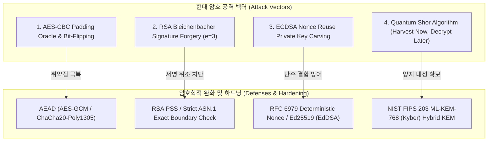
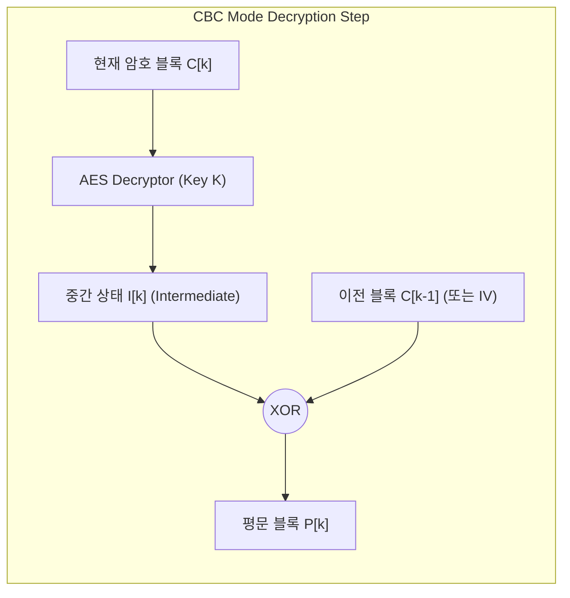
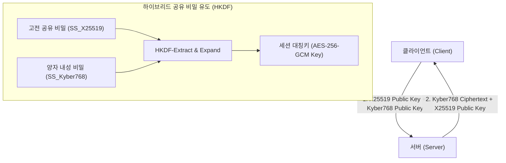

# 현대 응용 암호학 취약점 & 포스트 퀀텀 하이브리드 방어 심층 분석 (Modern Cryptanalysis & Post-Quantum Hybrid Defense Deep-dive)

> **섹션**: 16_Cryptography | **난이도**: 고급 (Advanced) | **대상**: 암호 분석관, 보안 아키텍트, 레드팀 익스플로잇 연구원, 블루팀 암호 엔지니어

---

## 1. 개요 및 현대 암호학의 공격 표면 (Applied Cryptanalysis Attack Surfaces)

현대 디지털 보안 인프라의 신뢰성은 수학적 난제(이산대수, 소인수분해, 격자 문제)에 기반한 암호학적 원시(Cryptographic Primitives)에 전적으로 의존합니다.
그러나 알고리즘 자체의 수학적 강도와는 무관하게, **운용 모드(Mode of Operation)의 구조적 결함**, **패딩 오류 피드백(Padding Oracle)**, **난수 생성 엔트로피 결함(Nonce Reuse)**, **불완전한 서명 검증 파서**, 그리고 다가오는 **양자 컴퓨팅(Shor's Algorithm)**의 위협은 암호화된 통신을 완전히 무력화시킬 수 있습니다.



---

## 2. AES-CBC 패딩 오라클 및 비트 플리핑 심층 분석

### 2.1 PKCS#7 패딩과 오라클 부채널(Error Oracle) 형성
블록 암호(AES-128, 블록 크기 $B = 16$ 바이트)는 평문 길이가 블록 크기의 배수가 아닐 때 PKCS#7 패딩을 사용합니다.
추가해야 하는 패딩 바이트 수를 $L$ ($1 \le L \le 16$)이라 할 때, 값 $L$을 $L$번 덧붙입니다.

$$\text{Padded} = P \parallel \underbrace{[L, L, \dots, L]}_{L \text{ bytes}}$$

* **Vaudenay (2002) 패딩 오라클 취약점**:
  서버가 복호화 후 패딩 유효성 검사 결과를 HTTP 상태 코드(200 OK vs 400/500 Bad Padding)나 에러 메시지로 반환할 때 발생합니다.



### 2.2 중간 상태(Intermediate State) 1바이트 역산 알고리즘
복호화 과정은 다음과 같이 전개됩니다:
$$P_k[i] = I_k[i] \oplus C_{k-1}[i]$$

공격자가 조작된 이전 블록 $C'_{k-1}$을 전송하여 마지막 바이트의 패딩이 $0x01$이 되도록 만들면:
$$I_k[15] \oplus C'_{k-1}[15] = 0x01 \implies I_k[15] = C'_{k-1}[15] \oplus 0x01$$

이로부터 원본 평문 바이트를 즉시 역산할 수 있습니다:
$$P_k[15] = I_k[15] \oplus C_{k-1}[15]$$

1개 블록(16바이트)을 복호화하는 데 필요한 최대 오라클 질의 수는 $16 \times 256 = 4,096$ 회에 불과합니다.

### 2.3 IV 비트 플리핑(Bit-Flipping) 공격
복호화 없이도 권한 상승을 달성할 수 있는 강력한 기법입니다.
평문의 첫 번째 블록 $P_0$은 $\text{IV}$와 직접 XOR되므로, $\text{IV}$의 특정 위치 비트를 반전시키면 복호화된 평문의 해당 바이트가 동일하게 조작됩니다.

$$P'_0[i] = P_0[i] \oplus (\text{IV}[i] \oplus \text{IV}'[i])$$

* **실전 시나리오**:
  - 원본 평문: `admin=0;role=user;uid=1092`
  - 목표 평문: `admin=1;role=user;uid=1092`
  - 오프셋 6번 바이트 (`'0'`)를 `'1'`로 변경하기 위한 조작:
    $$\text{IV}'[6] = \text{IV}[6] \oplus \text{'0'} \oplus \text{'1'}$$
  - **결과**: 블록 파괴나 패딩 에러 없이 완벽한 관리자 세션 획득!

---

## 3. RSA Bleichenbacher PKCS#1 v1.5 서명 위조 (e=3)

### 3.1 PKCS#1 v1.5 서명 인코딩 규격
RSA 디지털 서명 검증 시, 해시 $H = \text{SHA256}(M)$는 다음과 같은 256바이트(2048비트 키 기준) EM(Encoded Message) 블록으로 포맷팅되어야 합니다:

$$\text{EM} = \mathtt{0x00} \parallel \mathtt{0x01} \parallel \mathtt{0xFF} \dots \mathtt{0xFF} \parallel \mathtt{0x00} \parallel \text{ASN.1 DigestInfo} \parallel H$$

### 3.2 취약한 파서의 구조적 결함 (Bleichenbacher '06)
일부 비표준/레거시 검증 파서는 서명의 세 제곱 $s^3 \pmod N$을 계산한 후, 시작 바이트 패턴(`0x00 0x01 0xFF ... 0x00` + ASN.1 + Hash)만 정규식이나 접두사로 확인하고, 그 뒤에 오는 바이트가 끝까지 패딩되어 있는지 검사하지 않는 치명적 결함을 가집니다.

```
+------+------+------+------+--------------------+------+---------------------+
| 0x00 | 0x01 | 0xFF | 0x00 | ASN.1 DigestInfo   | HASH | Garbage Bytes (무시) |
+------+------+------+------+--------------------+------+---------------------+
```

### 3.3 정수 세제곱근(Cube Root) 서명 위조 수학적 증명
공개 지수가 작은 $e = 3$일 때:
타깃 접두사를 $D = \mathtt{0x00} \parallel \mathtt{0x01} \parallel \mathtt{0xFF} \parallel \mathtt{0x00} \parallel \text{ASN.1} \parallel H$ 라 하고, 나머지 바이트를 0으로 채운 2048비트 정수를 구성합니다.

$$D_{\text{num}} = D \times 2^{8 \times \text{rem}}$$

공격자는 모듈로 $N$을 감싸지 않는(Wrap-around 없는) 순수 정수 세제곱근을 취합니다:
$$s = \left\lceil \sqrt[3]{D_{\text{num}}} \right\rceil$$

이때 $s^3$과 $D_{\text{num}}$의 차이는 다음과 같이 제한됩니다:
$$(s+1)^3 - s^3 \approx 3s^2 \approx 3 D_{\text{num}}^{2/3}$$

2048비트 키에서 $D_{\text{num}}$의 비트 길이가 2048비트일 때, $D_{\text{num}}^{2/3}$의 비트 길이는 약 1,365비트입니다.
반면 남은 가비지 공간(rem)은 $256 - 55 = 201$ 바이트 = 1,608비트이므로:
$$1,365 \text{ bits} < 1,608 \text{ bits}$$

따라서 $s^3$의 최상위 55바이트(440비트)는 접두사 $D$와 완벽하게 일치하게 되어, **개인키 없이도 루트 인증서 서명을 위조할 수 있습니다.**

---

## 4. ECDSA 타원곡선 서명과 난수 재사용(Nonce Reuse) 취약점

### 4.1 ECDSA 서명 생성 프로토콜
타원곡선(secp256k1) 위의 점 생성원 $G$, 곡선 차수 $n$, 개인키 $d$에 대해:
1. 메시지 해시 $z = \text{SHA256}(M) \pmod n$
2. 암호학적으로 안전한 임시 비밀 난수 $k \in [1, n-1]$ 생성
3. 곡선 점 계산 $(x_1, y_1) = k \cdot G$, $r = x_1 \pmod n$
4. 서명 값 계산:
   $$s = k^{-1} (z + r \cdot d) \pmod n$$

### 4.2 소니 PS3 해킹(CVE-2010-4740)의 수학적 원리
만약 두 개의 서로 다른 메시지 $M_1, M_2$에 대해 동일한 난수 $k$를 재사용하면, 두 서명은 동일한 $r$을 갖게 됩니다:

$$s_1 = k^{-1}(z_1 + r \cdot d) \pmod n$$
$$s_2 = k^{-1}(z_2 + r \cdot d) \pmod n$$

두 식을 빼면 미지수 $d$가 소거됩니다:
$$s_1 - s_2 = k^{-1}(z_1 - z_2) \pmod n$$

모듈러 역원을 취하여 난수 $k$를 즉시 복원합니다:
$$k = (z_1 - z_2)(s_1 - s_2)^{-1} \pmod n$$

복원된 $k$를 다시 대입하여 타원곡선 개인키 $d$를 완전히 역산합니다:
$$d = r^{-1}(s_1 \cdot k - z_1) \pmod n$$

---

## 5. 포스트 퀀텀 암호(PQC)와 ML-KEM-768 하이브리드 키 교환 방어

### 5.1 쇼어(Shor) 알고리즘의 위협과 양자 취약성
양자 컴퓨터는 양자 중첩과 양자 푸리에 변환(QFT)을 활용하여 모듈러 지수 함수의 주기를 다항 시간($O(\log^3 N)$)에 찾아냅니다.
이로 인해 RSA(소인수분해 문제)와 ECDH/ECDSA(타원곡선 이산대수 문제)는 양자 컴퓨터 출현 시 완전히 붕괴됩니다.

### 5.2 Harvest Now, Decrypt Later (HNDL) 위협
적대적 국가지원 공격 그룹은 현재의 암호화된 트래픽을 대량으로 수집·저장(Harvest)한 후, 수년 뒤 고성능 양자 컴퓨터가 개발되는 즉시 복호화(Decrypt)하는 위협을 실행하고 있습니다.

### 5.3 NIST FIPS 203 ML-KEM-768 (Kyber) 하이브리드 KEM 설계
현재의 보안성과 미래의 양자 내성을 동시에 충족하기 위해, IETF 및 NIST는 고전 X25519와 격자 기반 모듈-LWE(ML-KEM-768)를 결합한 하이브리드 KEM을 표준으로 채택했습니다:



$$\text{Shared Secret} = \text{HKDF}(\text{SS}_{\text{X25519}} \parallel \text{SS}_{\text{Kyber768}})$$

이 하이브리드 구조는 둘 중 하나의 암호 체계가 돌파되더라도 세션 키가 노출되지 않는 "이중 안전망(Dual Security)"을 보장합니다.

---

## 6. 실전 실습 연계 및 방어 매트릭스 (Lab 39 & Wargame)

| 공격 벡터 | 취약점 메커니즘 | 실전 익스플로잇 기법 | 하드닝 및 방어 표준 | 연계 실습 / 워게임 |
| :--- | :--- | :--- | :--- | :--- |
| **CBC Padding Oracle** | 복호화 후 패딩 오류 피드백 누출 | Vaudenay 오라클 질의 & 바이트 역산 | AEAD (AES-GCM) 도입, Encrypt-then-MAC | **Lab 39 Stage 1**, Track 53 `crypto` |
| **CBC Bit-Flipping** | 이전 블록/IV 변조 시 평문 1:1 변경 | IV[6] ^= '0' ^ '1' 조작 관리자 승격 | 암호문 무결성 HMAC 검증 강제 | **Lab 39 Stage 1**, Track 53 `crypto` |
| **Bleichenbacher '06** | RSA $e=3$ PKCS#1 v1.5 느슨한 파서 | 정수 세제곱근 $s = \lceil \sqrt[3]{D} \rceil$ 계산 위조 | RSA PSS 채택, 엄격한 ASN.1 경계 파서 | **Lab 39 Stage 2**, Track 53 `crypto` |
| **ECDSA Nonce Reuse** | 서명 난수 $k$ 중복 재사용 | $k = \Delta z / \Delta s$, $d = r^{-1}(s_1 k - z_1)$ 개인키 복원 | RFC 6979 결정론적 k 생성, Ed25519 마이그레이션 | **Lab 39 Stage 3**, Track 53 `crypto` |
| **Quantum Shor Attack** | 고전 RSA/ECC 이산대수 다항시간 붕괴 | 양자 시뮬레이션 기반 세션 키 분해 | NIST FIPS 203 ML-KEM-768 하이브리드 키 교환 | **Lab 39 Stage 4**, Track 53 `crypto` |

```bash
# Lab 39 실행 및 검증
vhack lab start 39
vhack solve 39 --step 1
vhack solve 39 --step 2
vhack solve 39 --step 3
vhack solve 39 --step 4
```
