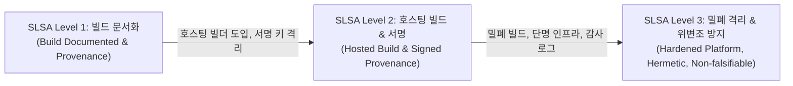

> 🌐 **Language / 언어**: [🇰🇷 한국어](#한국어) | [🇺🇸 English](#english)

---

<a name="한국어"></a>

# 소프트웨어 공급망 보안 심층 분석: SLSA v1.0, Sigstore, CycloneDX SBOM 및 빌드 파이프라인 방어 아키텍처

> 🏢 **연계 실습 랩**: [Lab 41: SupplyChainShield - Software Supply Chain Security Lab](../../labs/41_supply_chain_security_lab)  
> 🎯 **관련 워게임 트랙**: `sbom` (소프트웨어 공급망 보안·SBOM & SLSA 35제)  
> 🛠️ **관련 시뮬레이터**: [Wargame Playground: SBOM & Supply Chain Dependency Inspector](../../wargame/index.html#playground)

---

## 0. 개요: 현대 소프트웨어 공급망의 신뢰 위기와 공격 표면

현대 애플리케이션의 80%~90% 이상은 오픈소스 라이브러리와 서드파티 패키지로 구성됩니다. 개발자가 직접 작성하는 코드는 전체 코드베이스의 일부분에 불과하며, 애플리케이션의 런타임 안정성과 보안은 수천 개의 간접 의존성(Transitive Dependencies), 서드파티 CI/CD 액션, 빌드 인프라의 신뢰성에 전적으로 종속됩니다.

2020년 SolarWinds 빌드 파이프라인 침투(Sunburst), 2021년 Alex Birsan의 Dependency Confusion(종속성 혼동 공격), Codecov Bash Uploader 변조 사태, 2024년 xz-utils(CVE-2024-3094)의 고도화된 다단계 M4/IFUNC 백도어 삽입 사건은 **"소스 코드가 안전하더라도 빌드 파이프라인과 의존성이 오염되면 최종 바이너리는 완전히 무력화된다"**는 사실을 명백히 증명했습니다.

```
+---------------------------------------------------------------------------------------------------+
|                        소프트웨어 공급망 전체 라이프사이클의 주요 공격 지점                       |
+---------------------------------------------------------------------------------------------------+

 [개발자 환경]       [소스 저장소]         [CI/CD 빌드]          [아티팩트 저장소]       [배포 / 런타임]
 ┌──────────┐        ┌──────────┐        ┌──────────┐          ┌──────────┐          ┌──────────┐
 │ 개발자   │──(A)──>│ GitHub / │──(B)──>│ CI Runner│───(C)───>│ OCI /    │───(D)───>│ K8s /    │
 │ 워크스팟 │        │ GitLab   │        │ Actions  │          │ PyPI/npm │          │ Prod Pod │
 └──────────┘        └──────────┘        └──────────┘          └──────────┘          └──────────┘
      ▲                   ▲                   ▲                      ▲                     ▲
      │                   │                   │                      │                     │
 [공격 벡터 A]       [공격 벡터 B]       [공격 벡터 C]          [공격 벡터 D]         [공격 벡터 E]
 개발자 계정 탈취    PR 악성 코드 주입   Pwn Request / PPE     Dependency Confusion   무서명 컨테이너
 SSH/GPG 키 유출     커밋 위조           서드파티 Action 변조   공개 레지스트리 선점   위변조 이미지 기동
 Typosquatting 설치  리뷰 승인 우회      Runner 탈취 & Secret   악성 릴리즈 업로드     VEX 무시 배포
```

본 심층 분석에서는 소프트웨어 공급망 보안의 양대 축인 **SLSA(Supply-chain Levels for Software Artifacts) v1.0 프레임워크**와 **SBOM(CycloneDX/SPDX/VEX) 엔지니어링**, 그리고 **Sigstore 암호학적 서명 체계**를 기술적으로 해부하고 엔터프라이즈 레벨의 철통 방어 체계를 확립하는 방법을 다룹니다.

---

## 1. SLSA v1.0 (Supply-chain Levels for Software Artifacts) 프레임워크 해부

SLSA는 오픈소스 보안 재단(OpenSSF)과 Google 주도로 개발된 소프트웨어 공급망 보안 표준 규격입니다. 소스 코드 커밋부터 최종 아티팩트 배포까지의 무결성(Integrity)과 변조 불가능성(Tamper-resistance)을 보장하기 위한 단계별 요구사항을 정의합니다.

### 1.1 SLSA v1.0 레벨 체계와 보안 보장



1. **SLSA Level 1 (기본 무결성 증명)**:
   - 빌드 프로세스가 명시적으로 문서화되어야 합니다.
   - 빌드 아티팩트와 함께 빌드 출처 증명서(Provenance)가 자동 생성되어야 합니다.
   - 소비자가 빌드가 어떻게 이루어졌는지 확인할 수 있으나, 출처 증명서의 변조 방지는 보장되지 않습니다.
2. **SLSA Level 2 (호스팅 빌드 및 암호학적 서명)**:
   - 개발자의 로컬 머신이 아닌 신뢰할 수 있는 호스팅 빌드 서비스(예: GitHub-hosted runners, Google Cloud Build)에서 빌드가 수행되어야 합니다.
   - 빌드 서비스가 직접 서명한 출처 증명서(Signed Provenance)가 생성되어야 합니다.
   - 빌드 서비스만이 서명 개인키에 접근할 수 있어, 개발자나 외부 공격자가 임의로 증명서를 위조할 수 없습니다.
3. **SLSA Level 3 (고강도 격리 및 변조 불가능한 출처 보장)**:
   - **위변조 방지 출처(Non-falsifiable Provenance)**: 사용자가 빌드 파라미터나 환경을 조작하더라도 빌드 플랫폼이 기록한 출처 메타데이터를 속일 수 없습니다.
   - **격리된 빌드 환경(Isolated / Ephemeral Builders)**: 각 빌드는 다른 빌드와 완전히 격리된 단명(ephemeral) 컨테이너/VM에서 실행되어 이전 빌드의 잔여물이나 악성 프로세스로부터 안전합니다.
   - **밀폐 빌드(Hermetic Builds)**: 빌드 실행 중 외부 인터넷 통신이 원천 차단되며, 사전에 해시가 고정된 의존성 패키지만이 빌드 환경에 주입됩니다. 빌드 도중 임의의 원격 코드가 다운로드되는 공급망 중독을 원천 방지합니다.

### 1.2 in-toto Attestation 및 SLSA v1.0 Provenance 스키마

SLSA 출처 증명서는 **in-toto Attestation 표준 프레임워크**를 채택하며, JSON-LD 기반의 명세를 따릅니다.

```json
{
  "_type": "https://in-toto.io/Statement/v1",
  "subject": [
    {
      "name": "registry.corp.internal/apps/payment-service",
      "digest": {
        "sha256": "4b6f131a98075f73909772bf6244f76269eb7f5c76dafd4de470be31969d2d0b"
      }
    }
  ],
  "predicateType": "https://slsa.dev/provenance/v1",
  "predicate": {
    "buildDefinition": {
      "buildType": "https://actions.github.com/workflow/v1",
      "externalParameters": {
        "workflow": {
          "ref": "refs/heads/main",
          "repository": "https://github.com/corp-sec/payment-core",
          "path": ".github/workflows/slsa-release.yml"
        }
      },
      "internalParameters": {
        "github": {
          "event_name": "push",
          "repository_id": "89234812",
          "runner_environment": "github-hosted"
        }
      },
      "resolvedDependencies": [
        {
          "uri": "git+https://github.com/corp-sec/payment-core@refs/tags/v2.4.0",
          "digest": {
            "gitCommit": "a1f8c2e94710bc8917d0c37f4810237da0927e1f"
          }
        }
      ]
    },
    "runDetails": {
      "builder": {
        "id": "https://github.com/slsa-framework/slsa-github-generator/.github/workflows/generator_generic_slsa3.yml@refs/tags/v2.0.0"
      },
      "metadata": {
        "invocationId": "https://github.com/corp-sec/payment-core/actions/runs/1089238472",
        "startedOn": "2026-10-16T08:30:00Z",
        "finishedOn": "2026-10-16T08:34:12Z"
      }
    }
  }
}
```

---

## 2. SBOM (Software Bill of Materials) 엔지니어링 및 VEX 트리아지

### 2.1 CycloneDX 1.6 vs SPDX 3.0 구조적 비교

소프트웨어 자재명세서(SBOM)는 애플리케이션을 구성하는 모든 소프트웨어 컴포넌트, 패키지 버전, 라이선스, 암호학적 해시, 의존성 관계 그래프를 기계 판독 가능한 표준 형식으로 기술한 명세서입니다.

| 비교 항목 | CycloneDX 1.6 (OWASP 주도) | SPDX 3.0 (Linux Foundation / ISO 5962) |
| :--- | :--- | :--- |
| **태생 목적** | 애플리케이션 보안, 취약점 분석, 공급망 위험 평가 | 오픈소스 라이선스 컴플라이언스, 저작권 추적 |
| **포맷 지원** | JSON, XML, Protocol Buffers | JSON-LD, YAML, RDF, Tag:Value |
| **주요 스키마 영역** | Components, Services, Vulnerabilities, Dependencies, VEX, Cryptography (CBOM) | Elements, Artifacts, Packages, Files, Licensing, Profiles |
| **의존성 그래프** | `dependencies` 필드 내 `ref` 및 `dependsOn` 배열로 직관적 방향 그래프 모델링 | `Relationships` 관계 트리플(`SPDXRef-A DEPENDS_ON SPDXRef-B`) 모델 |
| **식별자 체계** | Package URL (purl), CPE 2.3, SWID, OmniBOR | SPDX ID (`SPDXRef-Package-...`), purl |
| **클라우드/SaaS 지원**| Services, Data Flow, Machine Learning Bill of Materials (AIBOM) | AI/Dataset 프로파일 확장 |

### 2.2 Package URL (purl) 식별 표준 규격

취약점 데이터베이스(CVE, NVD, OSV, GHSA)와 SBOM 컴포넌트를 정확하게 매핑하기 위해 RFC 기반의 표준 URI 규격인 `purl`이 사용됩니다.

```
scheme:type/namespace/name@version?qualifiers#subpath
```

* **Python PyPI**: `pkg:pypi/requests@2.31.0`
* **Node.js npm**: `pkg:npm/%40angular/core@17.0.0` (네임스페이스 `%40` 인코딩)
* **Debian OS 패키지**: `pkg:deb/debian/liblzma5@5.6.0-0.2?arch=amd64&distro=debian-12`
* **컨테이너 이미지**: `pkg:oci/payment-app@sha256:4b6f131a98075f73909772bf...`

### 2.3 VEX (Vulnerability Exploitability eXchange)와 오탐 트리아지

취약점 스캐너(Grype, Trivy)가 SBOM을 분석할 때, 실제로는 사용되지 않는 코드 경로(Dead code)나 라이브러리의 비활성화된 기능에 존재하는 CVE로 인해 수천 개의 경보 피로(Alert Fatigue)가 발생합니다. **VEX**는 컴포넌트에 CVE가 포함되어 있더라도 해당 애플리케이션 맥락에서 실제로 악용 가능한지 여부를 공급업체가 공식 선언하는 메타데이터입니다.

#### OpenVEX 상태(Status) 규격
1. **`not_affected`**: 컴포넌트에 취약한 코드가 포함되어 있으나 시스템 영향 없음.
   - 필수 정당성 사유(`justification`):
     - `vulnerable_code_not_present`: 해당 빌드에서 취약한 소스 파일이나 모듈이 컴파일에서 제외됨
     - `vulnerable_code_not_in_execute_path`: 취약한 진입점이 런타임 콜 그래프에서 호출되지 않음
     - `vulnerable_code_cannot_be_controlled_by_adversary`: 공격자가 취약한 파라미터에 사용자 입력을 전달할 수 없음
     - `inline_mitigations_already_exist`: 애플리케이션 레벨의 가드레일, 샌드박스, WAF 필터가 악용을 사전 차단함
2. **`affected`**: 시스템이 해당 CVE에 취약함 (패치 또는 완화 조치 필요).
3. **`fixed`**: 패치가 적용된 버전이 빌드에 반영됨.
4. **`under_investigation`**: 보안 분석팀이 현재 영향도를 분석 중임.

---

## 3. Sigstore 암호학적 신뢰 체계: Cosign, Fulcio, Rekor

전통적인 소프트웨어 서명 체계(GPG, 장기 보관 RSA 인증서)는 **개인키 유출**, **키 회전의 복잡성**, **취약한 중앙 인증 기관(CA)** 문제로 인해 대규모 공급망 자동화에 한계가 있었습니다. Sigstore는 이를 해결하기 위해 **키리스(Keyless) 서명 및 투명성 감사 로그**를 구현했습니다.

```
+---------------------------------------------------------------------------------------------------+
|                        Sigstore 키리스(Keyless) 서명 및 검증 시퀀스                               |
+---------------------------------------------------------------------------------------------------+

 [CI/CD Builder]            [Fulcio CA]             [Rekor Log]          [OCI Registry]     [K8s Admission]
        │                        │                       │                     │                   │
        │ 1. OIDC Token 획득      │                       │                     │                   │
        │    (GitHub/GitLab IdP) │                       │                     │                   │
        │ 2. 임시 키쌍 생성       │                       │                     │                   │
        │ 3. CSR + OIDC 전송     │                       │                     │                   │
        ├───────────────────────>│                       │                     │                   │
        │                        │ 4. OIDC Identity 검증 │                     │                   │
        │ 5. 단명 X.509 인증서 발급 │                       │                     │                   │
        │    (유효기간: 10분)    │                       │                     │                   │
        │<───────────────────────┤                       │                     │                   │
        │                                                │                     │                   │
        │ 6. 아티팩트 서명 수행                          │                     │                   │
        │ 7. 서명 메타데이터 + 인증서 제출               │                     │                   │
        ├───────────────────────────────────────────────>│                     │                   │
        │                                                │ 8. Merkle Tree 기록 │                   │
        │ 9. SET (Signed Entry Timestamp) 반환           │    (Append-Only Log)│                   │
        │<───────────────────────────────────────────────┤                     │                   │
        │                                                                      │                   │
        │ 10. 이미지 + 서명 + SET 업로드 (cosign sign)                          │                   │
        ├─────────────────────────────────────────────────────────────────────>│                   │
        │                                                                      │                   │
        │                                           11. 컨테이너 배포 시 검증 요청 (Pod Run)       │
        │                                                                      │<──────────────────┤
        │                                           12. Cosign 서명 / Fulcio 인증서 / Rekor 검증  │
        │                                                                      ├──────────────────>│
        │                                                                      │  (All OK -> 기동) │
```

### 3.1 3대 핵심 컴포넌트

1. **Cosign**:
   - 컨테이너 이미지(OCI 아티팩트), 바이너리, SBOM, SLSA Attestation에 대한 암호학적 서명 및 검증 CLI 도구.
   - OCI 레지스트리에 이미지 레이어와 동일한 네임스페이스(`*.sig`, `*.att`)로 서명 데이터를 저장.
2. **Fulcio (단명 인증 기관 - Ephemeral CA)**:
   - 빌더가 제공한 OIDC ID 토큰(예: GitHub Actions의 `sub: repo:corp/payment:ref:refs/heads/main`)을 검증하고, 공개키를 담은 **10분 유효기간의 단명 X.509 인증서**를 발급.
   - 장기 보관 개인키가 필요 없으므로 키 유출 위험이 원천 제거됨.
3. **Rekor (투명성 로그 - Tamper-proof Transparency Log)**:
   - Trillian Merkle Tree 기반의 추가 전용(Append-only) 불변 로그 서버.
   - 모든 서명 내역, 인증서, 해시가 전 세계에 공개 투명 기록되며, 서명 시점 증명(Signed Entry Timestamp, SET)을 반환.
   - 키 유출이나 CA 변조가 발생하더라도 사후 추적 및 부인 방지(Non-repudiation)를 완벽히 보장.

---

## 4. 실전 공격 시나리오와 침투 기법 해부

### 4.1 Dependency Confusion & Typosquatting (내부 네임스페이스 하이재킹)

* **Dependency Confusion (Alex Birsan)**:
  - 기업 내부 사내 패키지(`@corp-internal/payment-auth`, `corp-billing-utils`)를 npm이나 PyPI 등 공용 레지스트리에 등록하지 않고 사내 프라이빗 레지스트리(Artifactory/Nexus)에서만 사용할 때 발생.
  - 패키지 매니저(`pip`, `npm`)가 공용 레지스트리와 사내 레지스트리를 동시 검색하도록 설정된 경우, 기본적으로 더 높은 버전(예: 내부 `v1.2.0` vs 공용 `v99.0.0`)을 가진 공용 패키지를 우선 다운로드하는 취약점을 악용.
  - 공격자가 동일한 이름으로 악성 코드가 포함된 `v99.0.0` 패키지를 공용 PyPI에 등록하면, 내부 CI/CD 빌더 및 개발자 PC에서 자동으로 악성 패키지가 실행됨.
* **Typosquatting**:
  - 인기 라이브러리(`requests` -> `requsets`, `colorama` -> `colourama`)의 오타를 유도하여 악성 패키지를 유포하는 기법.
  - 설치 스크립트(`setup.py`, `package.json`의 `preinstall`) 내에 리버스 쉘이나 자격증명 수집기를 삽입.

### 4.2 Actions Pwn Request (GitHub Actions 권한 탈취)

* **취약한 워크플로우 트리거: `pull_request_target`**:
  - `pull_request` 트리거는 외부 포크(Fork) 저장소의 PR에 대해 읽기 전용 토큰과 빈 시크릿 컨텍스트를 제공하여 안전함.
  - 그러나 PR 코드를 빌드하고 라벨을 붙이거나 코멘트를 남기기 위해 `pull_request_target`을 사용하면서, **PR로 제출된 untrusted 코드를 직접 체크아웃하여 실행**하는 치명적 실수가 빈번함.

```yaml
# 취약한 워크플로우 안티패턴 (.github/workflows/ci.yml)
name: Insecure CI Runner
on:
  pull_request_target:  # 대상 리포지토리의 권한과 시크릿을 보유한 채 실행됨!

jobs:
  test:
    runs-on: ubuntu-latest
    steps:
      - uses: actions/checkout@v4
        with:
          ref: ${{ github.event.pull_request.head.sha }} # 공격자의 포크 PR 코드 체크아웃!
      - run: npm install && npm test                     # 공격자의 악성 preinstall 스크립트 실행!
        env:
          AWS_SECRET_ACCESS_KEY: ${{ secrets.AWS_PROD_DEPLOY_KEY }} # 기업 운영 시크릿 즉시 유출!
```

### 4.3 xz-utils (CVE-2024-3094) 다단계 백도어 삽입 분석

2024년 상반기 공개된 `xz-utils` 백도어는 다년간 신뢰를 쌓은 기여자 계정(Jia Tan)을 통해 배포 타르볼(Release Tarball)에만 악성 M4 매크로와 난독화된 테스트 바이너리를 주입한 역사상 가장 정교한 공급망 공격입니다.

1. **타르볼 독화(Tarball Poisoning)**: 공식 Git 저장소에는 악성 코드를 커밋하지 않고, 릴리즈 빌드 스크립트(`configure`)에 악성 M4 매크로를 몰래 삽입.
2. **다단계 추출**: 압축된 악성 테스트 데이터 파일(`tests/files/bad-3-corrupt_lzma2.xz`)에서 `sed`, `awk`, `tr`을 통해 쉘 스크립트와 ELF 공유 객체를 동적 디코딩.
3. **IFUNC(Indirect Function) 하이재킹**: OpenSSH 데몬(`sshd`)이 `systemd-notify`를 지원하기 위해 `liblzma`를 로드할 때, GNU ld 링커의 IFUNC 해석 단계에서 `RSA_public_decrypt` 심볼을 공격자의 은닉 인증 루틴으로 바꿔치기하여 원격 RCE 백도어 확보.

---

## 5. 엔터프라이즈 제로 트러스트 공급망 방어 아키텍처

```
+---------------------------------------------------------------------------------------------------+
|                        엔터프라이즈 제로 트러스트 소프트웨어 공급망 청사진                         |
+---------------------------------------------------------------------------------------------------+

 1. 개발자 환경                 2. 소스 저장소 & CI                 3. 승인 및 배포 컨트롤러
 ┌────────────────────────┐     ┌────────────────────────┐          ┌────────────────────────┐
 │ • Pre-commit Hook 검사 │     │ • Hermetic Build 실행  │          │ • K8s Admission Control│
 │ • 패키지 해시 Lockfile │────>│ • Syft: CycloneDX 생성 │─────────>│   (Kyverno / Gatekeeper│
 │ • GPG/SSH 커밋 서명    │     │ • Cosign: 키리스 서명  │          │ • Cosign 서명 유효성 검증│
 └────────────────────────┘     │ • SLSA-Verifier 검증   │          │ • Rekor SET 로그 검증  │
                                └────────────────────────┘          │ • 미인가/미서명 배포 차단│
                                                                    └────────────────────────┘
```

### 5.1 Hermetic Build & Pinning 가이드라인

1. **Commit SHA Pinning**:
   - 모든 CI 액션은 유동적인 태그(`@v3`, `@main`) 대신 불변의 Git 커밋 해시를 사용합니다.
   ```yaml
   - uses: actions/checkout@b4ffde65f46336ab88eb53be808477a3936bae11 # v4.1.1
   ```
2. **Lockfile 무결성 검증**:
   - 패키지 의존성은 반드시 해시가 포함된 락파일(`poetry.lock`, `package-lock.json`)을 통해서만 설치하며, 빌드 시 설치 변경을 금지합니다 (`npm ci --ignore-scripts`, `pip install --no-deps --require-hashes`).
3. **네트워크 격리 빌드**:
   - 빌드 러너는 의존성 캐싱 후 외부 인터넷 접속을 전면 차단(Egress 통제)하여 빌드 중 원격 페이로드 유입을 원천 방지합니다.

### 5.2 Kubernetes 배포 승인 제어 (Kyverno 정책 예시)

```yaml
apiVersion: kyverno.io/v1
kind: ClusterPolicy
metadata:
  name: verify-image-sigstore-policy
spec:
  validationFailureAction: Enforce
  webhookTimeoutSeconds: 30
  rules:
    - name: verify-cosign-and-slsa-provenance
      match:
        any:
          - resources:
              kinds:
                - Pod
      verifyImages:
        - imageReferences:
            - "registry.corp.internal/apps/*"
          attestors:
            - entries:
                - keyless:
                    issuer: "https://token.actions.githubusercontent.com"
                    subject: "https://github.com/corp-sec/*"
                    rekor:
                      url: "https://rekor.sigstore.dev"
          attestations:
            - predicateType: "https://slsa.dev/provenance/v1"
              conditions:
                - all:
                    - key: "{{ builder.id }}"
                      operator: Equals
                      value: "https://github.com/slsa-framework/slsa-github-generator/.github/workflows/generator_generic_slsa3.yml@refs/tags/v2.0.0"
```

---

<a name="english"></a>

# Deep-Dive: Enterprise Software Supply Chain Security, SLSA v1.0, Sigstore, CycloneDX SBOM, and CI/CD Pipeline Defense

> 🏢 **Hands-on Lab**: [Lab 41: SupplyChainShield - Software Supply Chain Security Lab](../../labs/41_supply_chain_security_lab)  
> 🎯 **Associated Wargame Track**: `sbom` (Software Supply Chain Security, SBOM & SLSA - 35 Challenges)  
> 🛠️ **Simulator**: [Wargame Playground: SBOM & Supply Chain Dependency Inspector](../../wargame/index.html#playground)

---

## 0. Introduction: The Crisis of Trust in Modern Software Delivery

Modern software applications are composed of over 85% open-source components and transitive dependencies. The surface area of software attacks has decisively shifted upstream: from exploiting runtime web vulnerabilities to corrupting the supply chain itself.

Prominent incidents such as SolarWinds (Sunburst build-injection), Dependency Confusion (Alex Birsan), Codecov bash uploader tampering, and the sophisticated xz-utils (CVE-2024-3094) multi-stage backdoor prove that **flawless application source code offers zero protection if the build pipeline or dependency tree is compromised.**

---

## 1. Deconstructing SLSA v1.0 (Supply-chain Levels for Software Artifacts)

Developed by the OpenSSF and Google, SLSA establishes an incremental maturity framework to guarantee end-to-end artifact integrity and prevent unauthorized modifications across source, build, and distribution stages.

### 1.1 SLSA v1.0 Levels

* **SLSA Level 1 (Build Process Documented)**:
  - Requires automated build scripts and generation of build provenance describing how the artifact was produced.
  - Provides visibility but does not protect against tampering.
* **SLSA Level 2 (Hosted Build Platform & Signed Provenance)**:
  - Builds must execute on a hosted build platform (e.g., GitHub-hosted runners) rather than developer workstations.
  - The build platform itself generates and cryptographically signs the provenance, preventing developers or attackers from modifying metadata after compilation.
* **SLSA Level 3 (Hardened Platform, Hermeticity & Ephemeral Isolation)**:
  - **Non-falsifiable Provenance**: Parameters and environment identities cannot be falsified by user-defined build steps.
  - **Ephemeral Isolated Builders**: Each build executes in an isolated, pristine container or VM that is destroyed immediately upon completion.
  - **Hermetic Builds**: Build steps run with external network access severed. All dependencies must be pre-fetched, pinned by cryptographic hash, and explicitly supplied.

---

## 2. SBOM Engineering & Vulnerability Exploitability eXchange (VEX)

### 2.1 CycloneDX 1.6 vs SPDX 3.0 Comparison

* **CycloneDX 1.6 (OWASP)**: Architected specifically for application security, vulnerability management, and automated DevSecOps pipelines. Natively supports components, services, dependency graphs, VEX statements, and Cryptographic Bill of Materials (CBOM).
* **SPDX 3.0 (Linux Foundation / ISO 5962)**: Rooted in open-source licensing compliance and copyright lineage, modeled as an extensive relationship graph with modular domain profiles.

### 2.2 Package URL (purl) Specification
Standardized canonical naming syntax across package registries:
`pkg:type/namespace/name@version?qualifiers#subpath`
- Example: `pkg:pypi/requests@2.31.0`, `pkg:npm/%40angular/core@17.0.0`

### 2.3 OpenVEX Triage & Justification Standards
VEX resolves security alert fatigue by formally asserting whether a reported vulnerability poses an actual exploitability threat within the deployed application:
- `not_affected`: Supported by standard justification criteria (`vulnerable_code_not_present`, `vulnerable_code_not_in_execute_path`, `vulnerable_code_cannot_be_controlled_by_adversary`, `inline_mitigations_already_exist`).
- `affected`, `fixed`, `under_investigation`.

---

## 3. Cryptographic Trust with Sigstore: Cosign, Fulcio, and Rekor

Sigstore obsoletes fragile long-lived PGP/RSA signing keys through automated **keyless signing**:

1. **Fulcio Ephemeral CA**: Validates OpenID Connect (OIDC) identity tokens issued by CI runners (e.g. GitHub Actions OIDC provider) and issues short-lived (10-minute validity) X.509 signing certificates.
2. **Cosign**: Signs container images, OCI artifacts, and in-toto attestations, storing signatures directly alongside images in OCI registries.
3. **Rekor Transparency Log**: Immutable, append-only Merkle tree log recording all signed metadata, providing non-repudiation and global auditability.

---

## 4. Attack Vectors: From Dependency Confusion to Actions Pwn Request

1. **Dependency Confusion**: Exploit package manager resolution logic by registering malicious public packages on PyPI/npm under unreserved enterprise internal package names with artificially inflated version numbers (`v99.0.0`).
2. **Actions Pwn Request**: Misconfiguring `pull_request_target` in GitHub Actions workflows while checking out untrusted PR head refs allows fork pull requests to execute arbitrary code with repository secrets and write tokens.
3. **xz-utils (CVE-2024-3094)**: Multi-stage tarball injection hijacking GNU IFUNC resolvers to hook OpenSSH authentication symbols at link time.

---

## 5. Enterprise Hardening Architecture

1. **Immutable Commit Pinning**: Pin all third-party CI actions to full 40-character commit SHAs.
2. **Strict Lockfile & Network Severing**: Use `npm ci --ignore-scripts` or `pip install --require-hashes` inside network-isolated builders.
3. **Zero-Trust Kubernetes Admission**: Enforce Sigstore signature and SLSA Level 3 provenance validation via Kyverno or Gatekeeper admission controllers before container pods can be scheduled.
