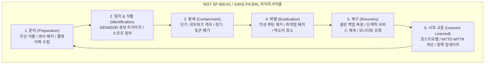
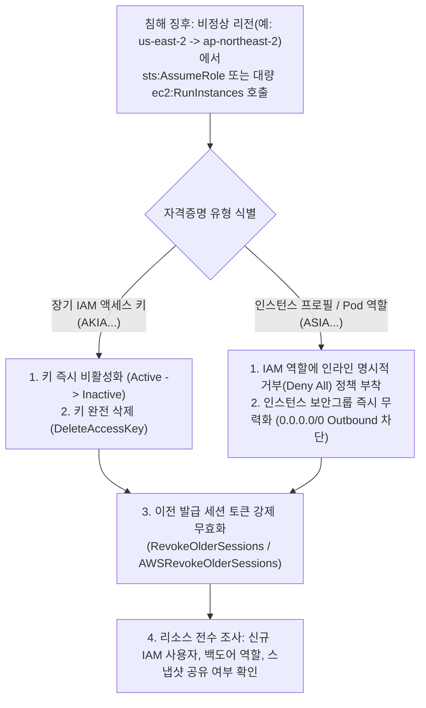

# 08. 엔터프라이즈 침해사고 대응 플레이북 및 DFIR 거버넌스 심층 가이드 (Enterprise Incident Response Playbook & DFIR Governance Deep-Dive)

> **대상**: CISO/CSIRT 리드, 엔터프라이즈 침해사고 대응팀(CERT), DFIR 포렌식 분석가, 블루팀 엔지니어  
> **핵심 표준**: NIST SP 800-61 Rev. 2 / Rev. 3, CISA Federal Incident Response Playbook, ISO/IEC 27035, SANS PICERL 프레임워크, MITRE ATT&CK  
> **선수 지식**: 엔터프라이즈 네트워크 아키텍처, Active Directory/클라우드 IAM 권한 모델, 포렌식 아티팩트(RAM/디스크/로그), 기본 Bash/Python 스크립팅

---

## 1. 개요: 엔터프라이즈 침해사고 대응(IR) 생애주기와 거버넌스

현대 엔터프라이즈 환경에서 보안 침해사고 대응은 단순한 "악성 프로세스 강제 종료"를 넘어, 기업 비즈니스 영속성(BCP), 법적 책임(Regulatory Liability), 브랜드 평판 보존을 아우르는 전사적 위기관리 체계입니다.



### 1.1 침해사고 심각도 매트릭스 (Severity Matrix)

사고 발생 시 자의적인 판단을 방지하기 위해 정량화된 심각도 등급을 사전에 정의해야 합니다:

| 등급 | 명칭 | 기준 및 영향도 | 소집 체계 및 보고 타임라인 |
| :---: | :--- | :--- | :--- |
| **P1** | **치명적 (Critical)** | 전사 코어 인프라 장악, 랜섬웨어 확산, 핵심 고객 DB 대량 유출 | 15분 내 전사 CSIRT 소집, 1시간 내 CISO/CEO 보고, 24시간 내 감독기관(KISA/개인정보위/SEC) 공시 |
| **P2** | **높음 (High)** | 도메인 컨트롤러(DC) 침해 시도, 내부망 횡적 이동, 클라우드 관리자 토큰 탈취 | 30분 내 IR 코어팀 소집, 4시간 내 경영진 중간 브리핑 |
| **P3** | **보통 (Medium)** | 단일 워크스테이션 악성코드 감염, 사용자 피싱 계정 유출(2FA 차단 성공) | 2시간 내 현업 담당자 연락 및 EDR 격리 조치 |
| **P4** | **낮음 (Low)** | 일반 스팸 유입, 포트 스캐닝 차단 로그, 단순 정책 위반 | 영업일 기준 정기 보고서(SOC Weekly) 취합 |

---

## 2. 실전 엔터프라이즈 대응 플레이북 (Playbook Workflows)

### 2.1 플레이북 A: 랜섬웨어 & 이중 갈취 (Ransomware & Double Extortion)

랜섬웨어 대응의 핵심 원칙은 **"선(先) 전파 차단, 후(後) 원인 분석"**입니다. 볼륨 섀도 복사본 삭제와 데이터 암호화가 진행 중일 때 망설임 없이 기계적 격리를 단행해야 합니다.

```mermaid
sequenceDiagram
    autonumber
    actor A as 공격자 (Ransomware)
    participant E as 감염 호스트 (Endpoint)
    participant SOC as SOC / IR 대응팀
    participant AD as Active Directory / DC
    participant B as 백업 스토리지 (Immutable)

    A->>E: vssadmin delete shadows & C2 통신
    E-->>SOC: EDR Alert: Mass File Rename / Canary File Triggered
    rect rgb(60, 20, 20)
        Note over SOC,E: 1. 즉각 격리 (0~15분)
        SOC->>E: EDR Network Isolation API 호출 (사설 IP 차단, EDR 통신만 유지)
        SOC->>AD: 감염 호스트 컴퓨터 계정 비활성화 & 서비스 티켓 취소
    end
    rect rgb(20, 40, 60)
        Note over SOC,AD: 2. 자격증명 무효화 및 횡적 이동 차단
        SOC->>AD: krbtgt 계정 1차 패스워드 리셋 (유효 티켓 무효화)
        SOC->>AD: 30분 대기 후 krbtgt 계정 2차 패스워드 리셋 (완전 무효화)
    end
    rect rgb(20, 50, 30)
        Note over SOC,B: 3. 복구 및 재발 방지
        SOC->>B: Air-Gapped 불변(WORM) 백업 무결성 해시 검증
        SOC->>E: 클린 골든 이미지 베어메탈 재배포 (OS Re-imaging)
    end
```



#### 기술적 실행 체크리스트:
1. **카나리 파일(Canary File) 검증**: 고유 엔트로피를 가진 감시 파일 변조 시 EDR이 호스트 I/O 자동 프리징.
2. **EDR 격리 실행**:
   ```bash
   # CLI 기반 엔드포인트 격리 (Linux / macOS 통합 에이전트 예시)
   sudo iptables -F
   sudo iptables -P INPUT DROP
   sudo iptables -P OUTPUT DROP
   sudo iptables -A OUTPUT -d 10.100.0.50 -p tcp --dport 8443 -j ACCEPT # EDR C2 전용
   sudo iptables -A INPUT -s 10.100.0.50 -p tcp --sport 8443 -j ACCEPT
   ```
3. **SMB/RPC 포트 전사 차단**: 네트워크 스위치 및 방화벽에서 TCP 445, 135, 139, 3389 임시 격리.

---

### 2.2 플레이북 B: 클라우드 IAM 자격증명 유출 및 메타데이터 피벗 (Cloud IAM Compromise)

클라우드 환경에서는 호스트 포렌식보다 **API 호출 감사 로그(CloudTrail, Cloud Audit Logs)**와 **단기 STS 세션 토큰 무력화**가 최우선 조치입니다.



#### AWS CLI 즉시 차단 실행 명령어:
```bash
#!/usr/bin/env bash
# Cloud IR 긴급 세션 무효화 스크립트

COMPROMISED_ROLE="EC2-Production-AppRole"
POLICY_NAME="EmergencyQuarantineDenyAll"

echo "[!] 침해 역할에 명시적 Deny 정책을 강제 부착합니다: ${COMPROMISED_ROLE}"

# 1. 모든 작업 차단 인라인 정책 생성
aws iam put-role-policy \
    --role-name "${COMPROMISED_ROLE}" \
    --policy-name "${POLICY_NAME}" \
    --policy-document '{
        "Version": "2012-10-17",
        "Statement": [
            {
                "Effect": "Deny",
                "Action": "*",
                "Resource": "*"
            }
        ]
    }'

# 2. 특정 시각 이전 발급된 모든 STS 임시 세션 토큰 강제 무효화
CURRENT_UTC=$(date -u +"%Y-%m-%dT%H:%M:%SZ")
aws iam put-role-policy \
    --role-name "${COMPROMISED_ROLE}" \
    --policy-name "AWSRevokeOlderSessions" \
    --policy-document "{
        \"Version\": \"2012-10-17\",
        \"Statement\": [
            {
                \"Effect\": \"Deny\",
                \"Action\": \"*\",
                \"Resource\": \"*\",
                \"Condition\": {
                    \"DateLessThan\": {
                        \"aws:TokenIssueTime\": \"${CURRENT_UTC}\"
                    }
                }
            }
        ]
    }"

echo "[+] 조치 완료: 모든 임시 자격증명 세션이 거부되었습니다."
```

---

## 3. 디지털 증거 수집(Triage) 및 포렌식 무결성 사슬

침해사고 증거는 법정에 제출되거나 사고 규명에 활용되므로, RFC 3227에 정의된 **휘발성 순서(Order of Volatility)**를 엄격히 준수해야 합니다.

### 3.1 휘발성 순서 (RFC 3227)
1. **CPU 레지스터, L1/L2/L3 캐시**: 나노초 단위 휘발
2. **라우팅 테이블, ARP 캐시, 프로세스 테이블, 커널 메모리(RAM)**: 전원 차단 시 즉시 소멸
3. **임시 파일시스템 및 스왑 공간**: 재부팅 시 덮어쓰기 발생
4. **로컬 디스크 비휘발성 저장소 (SSD/HDD)**: 영구 저장
5. **원격 로깅 시스템 및 네트워크 장비 로그**: 보존 정책에 따라 보관
6. **물리적 미디어(백업 테이프, DVD/WORM)**: 장기 보관

### 3.2 라이브 트리아지 자동화 스크립트 (Linux IR Helper)

```python
#!/usr/bin/env python3
"""
Enterprise Linux Incident Response Live Triage Collector
Gathers volatile artifacts preserving cryptographically signed SHA-256 integrity.
"""
import os
import subprocess
import hashlib
from datetime import datetime

OUTPUT_DIR = f"/tmp/dfir_triage_{datetime.utcnow().strftime('%Y%m%d_%H%M%S')}"
os.makedirs(OUTPUT_DIR, exist_ok=True)

COMMANDS = {
    "network_connections": "ss -tulpn",
    "process_tree": "ps auxf",
    "logged_in_users": "who -a",
    "open_files_network": "lsof -i -P -n",
    "kernel_modules": "lsmod",
    "cron_jobs": "crontab -l; ls -la /etc/cron*",
    "routing_table": "ip route show",
    "arp_cache": "ip neigh show"
}

manifest = []

print(f"[*] Live Triage 수집을 시작합니다. 대상 디렉토리: {OUTPUT_DIR}")

for name, cmd in COMMANDS.items():
    outfile = os.path.join(OUTPUT_DIR, f"{name}.txt")
    try:
        res = subprocess.run(cmd, shell=True, capture_output=True, text=True, timeout=15)
        with open(outfile, "w", encoding="utf-8") as f:
            f.write(res.stdout)
            if res.stderr:
                f.write(f"\n[STDERR]\n{res.stderr}")
        
        # SHA-256 해시 계산
        with open(outfile, "rb") as f:
            h = hashlib.sha256(f.read()).hexdigest()
        manifest.append(f"{h}  {name}.txt")
        print(f"  [+] {name}: 완료 (SHA256: {h[:12]}...)")
    except Exception as e:
        print(f"  [-] {name} 실행 실패: {e}")

# 증거 사슬(Chain of Custody) 매니페스트 저장
manifest_path = os.path.join(OUTPUT_DIR, "MANIFEST.sha256")
with open(manifest_path, "w", encoding="utf-8") as f:
    f.write("\n".join(manifest) + "\n")

print(f"[*] 수집 완료! 무결성 해시가 {manifest_path} 에 저장되었습니다.")
```

---

## 4. 침해 박멸(Eradication) 및 신원 완전 복구

공격자를 완전히 추방하기 위해서는 눈에 보이는 악성 파일 삭제뿐만 아니라, **잠복 지속성 기법(Hidden Persistence)**을 근절해야 합니다.

### 4.1 엔터프라이즈 환경에서의 완전 소거 4단계
1. **WMI 이벤트 구독 및 골든 SAML 인증서 폐기**: AD CS에서 발급된 비인가 인증서 전수 취소(CRL 갱신).
2. **Active Directory 'AdminCount=1' 보호 계정 감사**: SDProp에 의해 관리자 ACL이 상속된 잔여 계정 전수 점검.
3. **SID History 백도어 검출**:
   ```powershell
   # 악성 복제 SID History 속성 검출
   Get-ADUser -Filter * -Properties SIDHistory | Where-Object { $_.SIDHistory -ne $null } | Select-Object Name, SIDHistory
   ```
4. **Kerberos krbtgt 2회 연속 리셋 절차**:
   - `krbtgt` 비밀번호를 1회 변경하면 현재 유효한 TGT는 이전 비밀번호로 계속 복호화 가능합니다.
   - 1회차 리셋 후 복제 지연(Replication Latency, 통상 10~30분)을 거친 뒤 **2회차 리셋**을 수행해야 기존 공격자가 발급한 골든 티켓(Golden Ticket)이 100% 무효화됩니다.

---

## 5. SOAR 기반 자동화 플레이북 구현 (Automation)

반복적이고 긴급한 수집/격리 작업은 **SOAR(Security Orchestration, Automation and Response)** 파이프라인으로 1분 이내에 실행되어야 합니다.

```python
"""
SOAR Automated Quarantine & Triage Playbook (FastAPI/WebHook Integration)
"""
from typing import Dict, Any

class SOARResponseEngine:
    def __init__(self, edr_client, firewall_client, slack_client):
        self.edr = edr_client
        self.fw = firewall_client
        self.slack = slack_client

    def execute_p1_ransomware_playbook(self, alert_data: Dict[str, Any]) -> Dict[str, str]:
        host_id = alert_data.get("host_id")
        ip_addr = alert_data.get("src_ip")
        threat_name = alert_data.get("threat_name")

        log = []
        # Step 1: EDR 네트워크 격리
        self.edr.isolate_host(host_id)
        log.append(f"Host {host_id} isolated via EDR API.")

        # Step 2: 방화벽 C2 IP 차단
        c2_ip = alert_data.get("c2_ip")
        if c2_ip:
            self.fw.block_ip(c2_ip)
            log.append(f"C2 IP {c2_ip} blocked on perimeter firewall.")

        # Step 3: 실시간 메모리 덤프 명령 트리거
        self.edr.trigger_live_memory_dump(host_id, upload_s3_bucket="ir-forensics-vault")
        log.append(f"Memory dump job triggered for {host_id}.")

        # Step 4: CSIRT 슬랙 채널 워룸(War-Room) 생성 및 호출
        self.slack.send_alert(
            channel="#csirt-p1-alerts",
            message=f"🚨 [P1 CRITICAL] 랜섬웨어 격리 완료: {threat_name}\n" + "\n".join(log)
        )

        return {"status": "SUCCESS", "actions_executed": log}
```

---

## 6. 사후 검토(Lessons Learned) 및 재발 방지 피드백 루프

대응이 완료된 후 2주 이내에 모든 이해관계자가 참여하는 포스트모템 회의를 개최해야 합니다.

### 6.1 비난 없는 포스트모템(Blameless Post-Mortem) 5대 아젠다
1. **공격 타임라인(Timeline) 확정**: 최초 침투(Initial Access, T0)부터 탐지(T1), 격리(T2), 복구(T3)까지 분 단위 매핑.
2. **MTTD & MTTR 지표 분석**:
   - **MTTD (Mean Time to Detect)**: 침입 발생 후 보안팀이 인지할 때까지 걸린 시간.
   - **MTTR (Mean Time to Respond)**: 인지 후 위협을 격리/제거할 때까지 걸린 시간.
3. **근본 원인 분석(Root Cause Analysis)**: 패치 누락, MFA 미적용, 피싱 유입 등 단일 실패 지점 식별.
4. **미탐지 요인 분석**: EDR이 왜 우회되었는지(BYOVD 등), 방화벽 규칙의 빈틈은 무엇이었는지 기술적 평가.
5. **액션 아이템(Action Items) 부여**: 기한(Due Date)과 담당자(Owner)가 명시된 보안 강화 과제 도출.

---

## 7. 핵심 요약 및 실무 가이드라인

* **골든 아워(Golden Hour)**: 랜섬웨어 및 APT 공격은 최초 탐지 후 1시간 이내에 전파 여부가 결정됩니다. 주저 없는 호스트 네트워크 격리가 필수적입니다.
* **증거 훼손 방지**: 감염 PC의 전원 플러그를 무작정 뽑지 마십시오. 휘발성 RAM의 주입된 페이로드, 복호화 키, 네트워크 소켓 정보가 영구 소실됩니다.
* **완전한 박멸**: AD 환경에서는 `krbtgt` 2회 리셋, 서비스 계정 전수 패스워드 교체, 신뢰 관계 점검이 병행되지 않으면 공격자는 언제든 재진입합니다.
