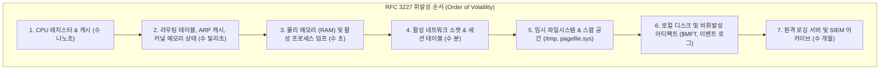
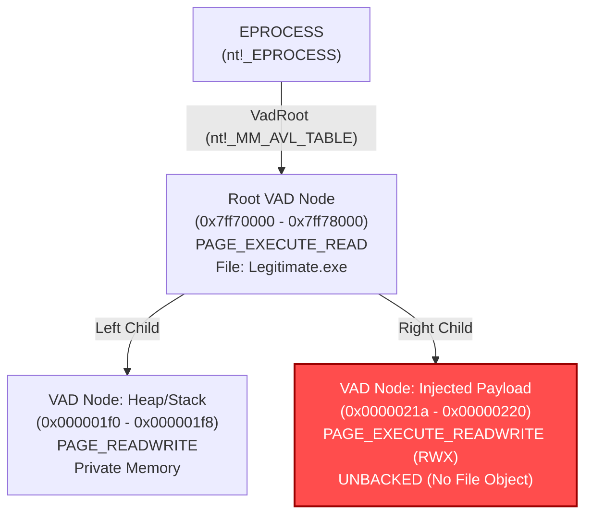
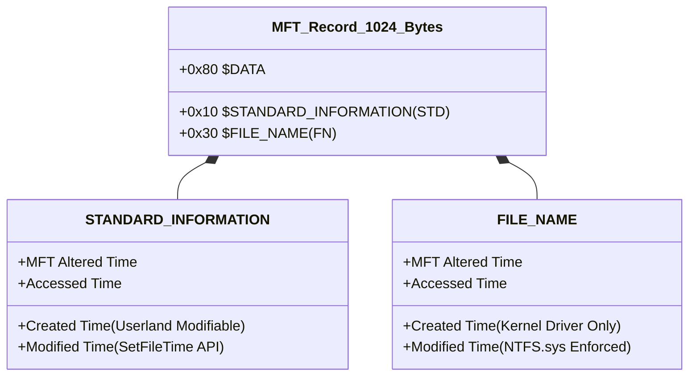
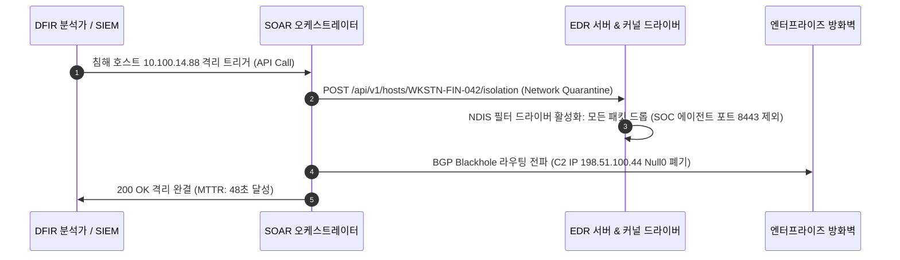

# 09. 엔터프라이즈 라이브 트리아지, 메모리 VAD 구조 분석 및 NTFS 타임라인 안티포렌식 무력화 심층 가이드 (Enterprise Live Triage, Memory VAD Forensics & Anti-Forensics Neutralization Deep-Dive)

> **대상**: CERT 침해사고 대응 분석가, DFIR 포렌식 엔지니어, 블루팀/SOC 위협 헌터, 보안 아키텍트  
> **핵심 표준**: RFC 3227 (증거 수집 및 보존 지침), NIST SP 800-86 (포렌식 통합 가이드), MITRE ATT&CK Enterprise (Defense Evasion, Command and Control)  
> **선수 지식**: Windows 커널 내부 구조(EPROCESS, PEB/TEB), NTFS 파일시스템 구조($MFT, USN Journal), Volatility 3 CLI 및 메모리 덤프 수집

---

## 1. 개요: 침해사고 초기 골든타임과 엔터프라이즈 라이브 트리아지 (Live Triage)

침해사고가 발생했을 때 초기 1시간(Golden Hour) 내의 대응 품질이 전사 피해 규모를 결정합니다. 현대 공격자들은 디스크에 흔적을 남기지 않는 파일리스(Fileless) 기법과 타임스톰프(Timestomping) 같은 안티포렌식(Anti-Forensics) 기술을 적극 활용하므로, 전원을 끄는 전통적인 사후 디스크 이미징 방식은 치명적인 휘발성 증거 손실을 유발합니다.

### 1.1 휘발성 순서 (Order of Volatility: RFC 3227)

엔터프라이즈 현장에서 라이브 트리아지는 휘발성이 높은 아티팩트부터 비휘발성 순으로 엄격히 수집되어야 합니다:



### 1.2 아티팩트 오염 최소화(Footprint Minimization) 원칙

라이브 트리아지 도구를 감염 의심 호스트에서 실행할 때 운영체제 메모리나 디스크에 새로운 프로세스를 대량 적재하면 원본 증거가 덮어씌워질 위험이 있습니다:
1. **정적 컴파일 도구 사용**: 타깃 시스템의 DLL을 참조하지 않는 단일 바이너리(Statically linked) 도구 활용.
2. **원격 EDR 에이전트 수집**: SSH나 로컬 콘솔 직접 로그인 대신 기설치된 EDR 드라이버 API를 통한 인메모리 텔레메트리 쿼리.
3. **네트워크 파이프라인 전송**: 덤프 파일을 로컬 디스크에 쓰지 않고 원격 증거 서버로 스트리밍 (`winpmem.exe - | nc forensic_vault 9999`).

---

## 2. 메모리 포렌식 심층: 커널 VAD 트리 구조와 파일리스 주입 트리아지

공격자가 사용하는 반사적 DLL 주입(Reflective DLL Injection)과 프로세스 할로잉(Process Hollowing)은 디스크에 악성 PE 파일을 쓰지 않고 합법적인 프로세스 메모리 공간에 직접 쉘코드를 적재합니다. 이를 규명하는 핵심 커널 구조체가 **VAD(Virtual Address Descriptor)**입니다.

### 2.1 EPROCESS와 VAD AVL 트리 구조

Windows 커널은 각 프로세스의 가상 주소 공간(`0x0000000000000000 ~ 0x7FFFFFFFFFFF`)을 효율적으로 추적하기 위해 자가 균형 이진 탐색 트리인 **AVL 트리** 형태로 VAD 노드를 관리합니다.



### 2.2 VAD 이상 징후 분석 지표

| 검증 항목 | 정상 프로세스 패턴 | 반사적 주입 / 쉘코드 이상 징후 |
| :--- | :--- | :--- |
| **메모리 보호 속성** | `PAGE_READONLY`, `PAGE_EXECUTE_READ` | **`PAGE_EXECUTE_READWRITE (RWX)`** |
| **백업 파일 객체** | `nt!_FILE_OBJECT` 가 연결됨 (디스크 DLL 기반) | **`Unbacked (Private Alloc)`**: 파일 매핑 없음 |
| **PEB 로드 모듈 목록** | `InLoadOrderModuleList`에 정식 등록됨 | **Unlinked**: PEB 목록에 은폐되어 나타나지 않음 |
| **MZ/PE 헤더 서명** | 디스크 이미지 헤더와 메모리 헤더가 100% 일치 | 디스크에 없는 고아 MZ 매직 바이트(`0x5A4D`) 발견 |

### 2.3 Volatility 3를 활용한 VAD 트리아지 명령어

```bash
# 1. 은폐된 프로세스 탐색 (ActiveProcessLinks 조작 DKOM 대응)
volatility3 -f memory.dmp windows.psscan

# 2. 특정 PID의 VAD 트리 덤프 및 권한 확인
volatility3 -f memory.dmp windows.vadinfo --pid 3320 --address 0x00007ff810400000

# 3. 비공개 실행 영역(RWX) 및 디스크 파일 미매핑 메모리 자동 탐지
volatility3 -f memory.dmp windows.malfind --pid 3320 --dump
```

---

## 3. 디스크 & 파일시스템 포렌식: NTFS $MFT 구조와 타임스톰프(Timestomping) 무력화

공격자가 침해 시스템에 페이로드를 설치한 후 가장 먼저 시도하는 은폐 기술은 정상 시스템 파일(예: `kernel32.dll`)의 생성 시각으로 악성 파일의 타임스탬프를 위조하는 **타임스톰프**입니다.

### 3.1 NTFS $MFT 레코드의 이중 타임스탬프 구조

NTFS 파일시스템의 모든 파일은 `$MFT`(Master File Table)의 1,024바이트 레코드에 메타데이터를 저장하며, 서로 다른 목적을 가진 두 개의 타임스탬프 속성을 유지합니다:



### 3.2 타임스톰프 탐지 매트릭스

1. **$STD vs $FN 시간 역전 현상**:
   - Win32 API인 `SetFileTime()`은 `$STANDARD_INFORMATION`의 시간만 변경할 수 있으며, `$FILE_NAME` 속성은 커널 모드 드라이버(`ntfs.sys`)만 수정할 수 있습니다.
   - 따라서 `$STANDARD_INFORMATION` 생성 시각이 2021년인데 `$FILE_NAME` 생성 시각이 2026년이라면 **100% 타임스톰프 공격**입니다.
2. **나노초(Nanosecond) 제로 패딩 이상**:
   - 표준 Windows NTFS 타임스탬프는 100나노초 단위(`0.0000001초`) 정밀도를 가집니다.
   - 일부 조잡한 타임스톰프 도구는 유닉스 타임스탬프(초 단위)를 변환하여 삽입하므로, 하위 밀리초/나노초 자리가 전부 `0000000`으로 채워지는 시그니처가 나타납니다.
3. **USN 저널(Update Sequence Number Journal) 교차 검증**:
   - 파일의 속성이 변경되면 `$UsnJrnl:$J`에 `USN_REASON_BASIC_INFO_CHANGE` 레코드가 실제 수정 시각으로 기록되므로, 위조된 시간과 저널 기록 시간의 불일치를 입증할 수 있습니다.

---

## 4. 실전 자동화 구현: MFT 이중 타임스탬프 및 VAD 이상 탐지기

다음은 침해사고 조사 시 $MFT 추출 CSV와 프로세스 메모리 영역 정보를 파싱하여 타임스톰프 및 메모리 주입을 자동으로 판정하는 파이썬 스크립트입니다:

```python
#!/usr/bin/env python3
"""
dfir_advanced_triage_analyzer.py
엔터프라이즈 MFT 타임스탬프 역전 및 VAD RWX 인메모리 주입 자동 판정기
"""

import datetime
from typing import Dict, Any, List

def analyze_mft_record(record: Dict[str, Any]) -> Dict[str, Any]:
    """
    $STANDARD_INFORMATION과 $FILE_NAME 속성을 비교하여
    타임스톰프 여부 및 신뢰성 판정
    """
    std_created = record.get("std_created") # datetime
    fn_created = record.get("fn_created")   # datetime
    file_path = record.get("file_path", "unknown")

    result = {
        "file": file_path,
        "is_timestomped": False,
        "confidence": "LOW",
        "anomaly_reason": []
    }

    if not std_created or not fn_created:
        return result

    # 1. $STD 와 $FN 간의 시간차 분석 (초 단위)
    delta_seconds = (fn_created - std_created).total_seconds()

    # $FN이 $STD보다 24시간 이상 미래인 경우 (공격자가 과거로 위조)
    if delta_seconds > 86400:
        result["is_timestomped"] = True
        result["confidence"] = "CRITICAL"
        result["anomaly_reason"].append(
            f"$FILE_NAME ({fn_created}) is {delta_seconds/86400:.1f} days ahead of $STD ({std_created})"
        )

    # 2. 나노초 제로 패딩 검사 (마이크로초가 정확히 0인지 확인)
    if std_created.microsecond == 0 and fn_created.microsecond != 0:
        result["is_timestomped"] = True
        result["confidence"] = "HIGH"
        result["anomaly_reason"].append(
            f"Suspicious sub-second zero-padding in $STD: {std_created.isoformat()}"
        )

    return result


def analyze_vad_region(vad_entry: Dict[str, Any]) -> Dict[str, Any]:
    """
    VAD 메모리 할당 속성을 검사하여 반사적 주입 의심 영역 판정
    """
    protection = vad_entry.get("protection", "")
    mapped_file = vad_entry.get("mapped_file", None)
    size_bytes = vad_entry.get("size", 0)

    is_malicious = False
    reasons = []

    # RWX 권한이면서 디스크 백업 파일이 없는 비공개 메모리
    if "PAGE_EXECUTE_READWRITE" in protection and not mapped_file:
        is_malicious = True
        reasons.append("Unbacked Private Allocation with PAGE_EXECUTE_READWRITE (RWX)")

    if is_malicious:
        return {
            "status": "MALICIOUS",
            "base_address": vad_entry.get("base"),
            "size": hex(size_bytes),
            "reasons": reasons
        }
    return {"status": "CLEAN"}


if __name__ == "__main__":
    sample_mft = {
        "file_path": "C:\\Windows\\System32\\drivers\\malware.sys",
        "std_created": datetime.datetime(2021, 4, 12, 9, 12, 0, 0),
        "fn_created": datetime.datetime(2026, 10, 13, 4, 15, 22, 418000)
    }

    sample_vad = {
        "base": "0x000001f4c0200000",
        "size": 0x64000,
        "protection": "PAGE_EXECUTE_READWRITE",
        "mapped_file": None
    }

    print("=== MFT TIMELINE AUDIT ===")
    mft_res = analyze_mft_record(sample_mft)
    print(f"File: {mft_res['file']}")
    print(f"Timestomped: {mft_res['is_timestomped']} (Confidence: {mft_res['confidence']})")
    for r in mft_res['anomaly_reason']:
        print(f" - {r}")

    print("\n=== VAD MEMORY AUDIT ===")
    vad_res = analyze_vad_region(sample_vad)
    print(f"VAD Region Status: {vad_res['status']}")
    if vad_res['status'] != "CLEAN":
        print(f"Base: {vad_res['base_address']} | Reasons: {', '.join(vad_res['reasons'])}")
```

---

## 5. C2 비콘 통신 규명 및 EDR/SOAR 자동 격리 연계

인메모리 악성코드는 커맨드 앤 컨트롤(C2) 서버와 통신할 때 탐지를 회피하기 위해 무작위 지터(Jitter)를 적용합니다.

### 5.1 비콘 지터(Jitter) 통계적 분석

정기적 비콘 간격이 $T$, 지터 비율이 $J$일 때 각 비콘 전송 시각 간격 $\Delta t$는 다음과 같이 모델링됩니다:

$$\Delta t \in [T \times (1 - J), T \times (1 + J)]$$

예컨대 $T = 60\text{초}$, $J = 20\%$라면 연결 간격은 $48\text{초} \sim 72\text{초}$ 사이의 균등 분포를 갖습니다. SOC 분석가는 네트워크 플로우 로그에서 표준편차 $\sigma$와 변동계수(Coefficient of Variation, $CV = \sigma / \mu$)를 계산하여 인간의 웹 브라우징(랜덤)과 C2 자동화 루틴(제한된 지터)을 명확히 구분할 수 있습니다.

### 5.2 SOAR 기반 호스트 격리 플레이북 (Host Isolation)

침해 사실이 확인되면 즉시 네트워크 레벨에서 호스트를 격리해야 합니다:



---

## 6. 결론 및 실습 연계

본 심층 가이드에서 다룬 엔터프라이즈 라이브 트리아지, VAD 트리 인메모리 역학, NTFS $MFT 타임스톰프 역전 판정 기법은 VibeHacking 생태계의 다음 실습 환경과 직접 연결됩니다:

- **실전 랩 실습**: [Lab 40: 엔터프라이즈 침해사고 대응 & DFIR 실전 랩 (IRShield)](../labs/40_enterprise_dfir_ir_lab/)
- **웹 워게임 콘솔**: 54번째 트랙 `dfir` (35개 챌린지) 및 10번째 시뮬레이터 `DFIR Live Triage & Memory Timeline Inspector`
- **CLI 터미널 학습**: `python3 vhack.py study 44 9`
