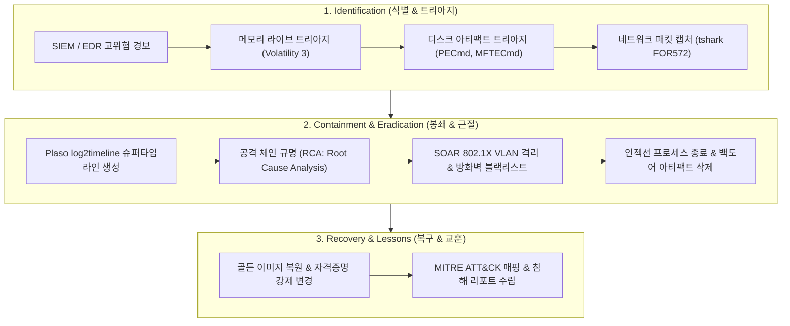
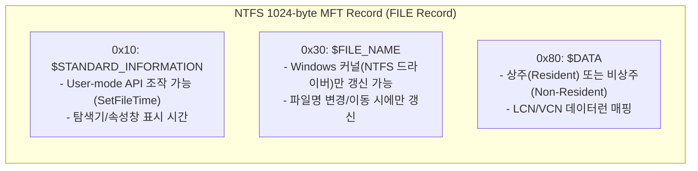

# 10. SANS FOR508/FOR572 기반 엔터프라이즈 침해사고 아티팩트 헌팅 및 슈퍼타임라인 분석 심층 가이드 (SANS FOR508/572 Enterprise Artifact Hunting & Supertimeline Analysis Deep-Dive)

> **대상**: CERT/CSIRT 침해사고 대응 분석가, DFIR 포렌식 수사관, SOC L3 위협 헌터, 엔터프라이즈 보안 아키텍트  
> **핵심 표준**: SANS Institute (FOR508: Advanced Incident Response & Threat Hunting, FOR572: Advanced Network Forensics), NIST SP 800-61 Rev.2, RFC 3227, MITRE ATT&CK Enterprise (TA0002 Execution, TA0003 Persistence, TA0005 Defense Evasion, TA0010 Exfiltration)  
> **선수 지식**: Windows 커널 객체(EPROCESS, VAD, Pool Tag), NTFS 아키텍처($MFT, $LogFile, USN Journal), Volatility 3 메모리 분석, Eric Zimmerman 도구군(PECmd, MFTECmd, AmcacheParser)

---

## 1. 개요 및 SANS IR 라이프사이클 (PICERL & 골든 아티팩트 매핑)

현대 엔터프라이즈 침해사고는 지능형 지속 위협(APT)과 랜섬웨어 카르텔에 의해 주도되며, 디스크에 단일 흔적만을 남기지 않고 메모리 인젝션, LOLBIN(Living-off-the-Land Binaries) 실행, 타임스톰프(Timestomping) 조작, DNS/ICMP 은닉 채널을 통한 유출 등 전방위적 안티포렌식 기법을 구사합니다.

SANS PICERL 6단계 대응 모델(Preparation -> Identification -> Containment -> Eradication -> Recovery -> Lessons Learned)을 충족하기 위해서는 단편적인 로그 조사를 넘어 **호스트 휘발성 메모리, 파일시스템 메타데이터, 네트워크 플로우**를 단일 슈퍼타임라인(Supertimeline)으로 융합하는 엔터프라이즈 헌팅 방법론이 필수적입니다.

### 1.1 SANS PICERL 아티팩트 헌팅 파이프라인



---

## 2. Windows Evidence of Execution 심층 규명 기법 (SANS FOR508)

공격자가 시스템에 악성코드를 배포했을 때, 바이너리가 삭제되었더라도 Windows 커널 및 서브시스템이 성능 최적화와 호환성을 위해 기록하는 **실행 증거(Evidence of Execution)** 아티팩트는 조작하기 극히 어렵습니다.

### 2.1 Prefetch (.pf) 파일 구조 및 PECmd 포렌식

Windows는 애플리케이션 시작 성능을 가속화하기 위해 첫 10초 동안 로드되는 페이지와 모듈 정보를 `C:\Windows\Prefetch\` 경로에 기록합니다.

1. **포맷 버전 차이**:
   - Windows 7: Version 23 (비압축)
   - Windows 8/8.1: Version 26 (비압축)
   - Windows 10/11: **Version 30** (LZNT1 / XPRESS 허프만 압축 적용, 매직 바이트 `MAM\x04`)
2. **핵심 메타데이터 필드**:
   - 실행 파일 이름 및 경로 해시 (`0x9e8a71b2`)
   - 실행 횟수 (Run Count)
   - 최근 실행 시각 (Last Execution Timestamps: 최대 8개 파일타임 기록)
   - 로드된 DLL 리스트 및 볼륨 일련번호(Volume Serial Number)

```bash
# Eric Zimmerman PECmd를 활용한 악성 프리패치 심층 파싱
PECmd.exe -f "C:\Windows\Prefetch\REVIL_RANSOMWARE.EXE-A4B8C19D.pf" --csv C:\DFIR\Triage\ --json C:\DFIR\Triage\
```

```
[+] Executable Name: REVIL_RANSOMWARE.EXE
[+] Hash: 0xA4B8C19D | Run Count: 1
[+] Last Run: 2026-10-24 14:22:08 UTC
[+] Referenced Files & DLLs (38 modules carved):
    -> C:\WINDOWS\SYSTEM32\NTDLL.DLL
    -> C:\WINDOWS\SYSTEM32\KERNEL32.DLL
    -> C:\USERS\ADMIN\APPDATA\LOCAL\TEMP\MIMILIB.DLL  <-- 악성 DLL 로드 정황 포착!
```

### 2.2 ShimCache (AppCompatCache) 및 Amcache.hve

| 구분 | ShimCache (AppCompatCache) | Amcache.hve |
| :--- | :--- | :--- |
| **저장 위치** | `SYSTEM\CurrentControlSet\Control\Session Manager\AppCompatCache` (레지스트리) | `C:\Windows\appcompat\Programs\Amcache.hve` (독립 하이브) |
| **업데이트 시점** | 시스템 정상 종료(Shutdown) 또는 재부팅 시 레지스트리에 플러시 | 프로세스 실행 직후 실시간 기록 |
| **추출 정보** | 파일 절대 경로, 표준 수정 시간, 실행 여부 플래그 (Executed Flag) | **SHA-1 바이너리 해시**, 컴파일 타임스탬프, PE 헤더 크기, 언인스톨 바이너리 정보 |
| **추천 분석 도구** | `AppCompatCacheParser.exe` | `AmcacheParser.exe` |

---

## 3. NTFS 파일시스템 메타데이터 및 안티포렌식 역추적

공격자는 흔적을 인멸하기 위해 `$STANDARD_INFORMATION`의 시간 속성을 정상 시스템 파일과 일치시키는 **타임스톰핑(Timestomping)**을 시도합니다.

### 3.1 $MFT 속성 비교: $STANDARD_INFORMATION (0x10) vs $FILE_NAME (0x30)



- **타임스톰핑 판별 규칙**:
  $$\Delta T = |T_{\text{SI\_Created}} - T_{\text{FN\_Created}}| > \epsilon$$
  $STANDARD_INFORMATION의 생성 시간이 $FILE_NAME의 생성 시간보다 과거이거나, 밀리초 단위 이하(100나노초 해상도)가 `0000000`으로 절삭(Truncated)된 경우 타임스톰핑 도구(`timestomp.exe`, Meterpreter) 사용의 결정적 증거입니다.

### 3.2 비상주 데이터런(Data Run) 카빙 및 삭제 파일 복원

`$DATA` 속성이 크기가 커서 MFT 레코드(1024바이트) 내에 저장될 수 없는 경우 비상주(Non-Resident) 데이터런이 형성됩니다.
```
Header: 0x80 ... Data Run 바이트 스트림: 32 30 00 00 E8 03
  - 길이 바이트(0x32): LCN 오프셋 필드 크기 3바이트, 클러스터 개수 필드 크기 2바이트
  - 클러스터 개수: 0x0030 = 48 클러스터 (48 * 4096 = 196,608 바이트)
  - 시작 LCN: 0x03E800 = 클러스터 256,000
```
공격자가 파일시스템 상에서 악성 바이너리를 언링크(삭제)하더라도, 클러스터 비트맵(`$Bitmap`)에서 할당 해제되었을 뿐 실제 클러스터 영역의 페이로드는 덮어씌워지기 전까지 온전히 보존됩니다.

---

## 4. 커널 메모리 포렌식 심층: Volatility 3 커널 객체 카빙

### 4.1 DKOM (Direct Kernel Object Manipulation) 은닉 프로세스 탐지

공격자는 루트킷이나 반사적 로더를 통해 `nt!_EPROCESS`의 이중 연결 리스트인 `ActiveProcessLinks`(`LIST_ENTRY`)를 언링크하여 `tasklist`나 `Process Explorer`에서 프로세스를 은닉합니다.

```bash
# 1. 활성 링크 리스트 기반 프로세스 열거 (은닉 프로세스 누락)
vol -f memory.raw windows.pslist

# 2. 커널 풀 태그('Proc' / 0x636f7250) 스캔을 통한 물리 메모리 전수 조사
vol -f memory.raw windows.psscan
```
`pslist`에는 출력되지 않지만 `psscan`에서 발견되는 PID(예: `svchost.exe (PID: 4920)`)는 DKOM 조작을 통한 프로세스 은닉 상태임을 입증합니다.

### 4.2 VAD(Virtual Address Descriptor) 트리 순회와 malfind

공격자가 실행한 반사적 DLL 주입(Reflective DLL Injection)은 디스크의 PE 파일과 매핑되지 않은(Unbacked) 상태에서 `PAGE_EXECUTE_READWRITE (RWX)` 권한을 가진 VAD 노드를 형성합니다.

```bash
# VAD 인젝션 의심 영역 덤프 및 디스어셈블리
vol -f memory.raw -p 4920 windows.malfind --dump
```
```
PID: 4920 (svchost.exe)
Process: svchost.exe
Base Address: 0x0000021b0000
End Address:  0x0000021b0fff
Tag: VadS | Protection: PAGE_EXECUTE_READWRITE | CommitCharge: 1 | PrivateMemory: 1
Heuristic: Unbacked RWX memory segment with MZ header
0000021b0000  4d 5a 90 00 03 00 00 00  04 00 00 00 ff ff 00 00  MZ..............
0000021b0010  b8 00 00 00 00 00 00 00  40 00 00 00 00 00 00 00  ........@.......
```

---

## 5. 네트워크 포렌식 (SANS FOR572) 및 프로토콜 카빙

### 5.1 tshark 기반 DNS C2 터널링 탐지

공격자는 방화벽 아웃바운드 차단을 우회하기 위해 DNS 질의 서브도메인에 자격증명과 C2 명령어를 인코딩하여 전송합니다.

```bash
# 서브도메인 길이 및 섀넌 엔트로피 기반 이상 DNS 질의 필터링
tshark -r incident_capture.pcap -Y "dns.flags.response == 0 and dns.qry.type == 16" \
  -T fields -e frame.time -e ip.src -e dns.qry.name
```
- **판별 기준**:
  - 서브도메인 레이블 길이 > 50글자
  - Shannon Entropy $H(X) = -\sum P(x) \log_2 P(x) > 3.8$
  - Base64 / Base32 패딩(`=`) 또는 16진수 문자열 빈도 집중

### 5.2 TLS JA3 / JA3S 핑거프린팅

암호화된 C2 통신(Cobalt Strike, Sliver, Havoc)은 페이로드를 복호화하지 않고도 TLS Client Hello 패킷의 5개 필드 해시값인 **JA3** 핑거프린트로 악성 도구를 판별할 수 있습니다:
$$\text{JA3} = \text{MD5}(\text{TLSVersion},\text{Ciphers},\text{Extensions},\text{EllipticCurves},\text{EllipticCurvePointFormats})$$

---

## 6. Plaso 슈퍼타임라인 재구성 및 SOAR 호스트 격리

### 6.1 log2timeline 통합 슈퍼타임라인 생성

```bash
# 1. 디스크 이미지 및 아티팩트 파싱하여 Plaso 스토리지 생성
log2timeline.py --parsers "win7,mft,usn,prefetch,esedb" /cases/case01/timeline.plaso /cases/case01/evidence.raw

# 2. 분석용 CSV 슈퍼타임라인 추출 (타임존 UTC 고정)
psort.py -z UTC -o l2tcsv -w /cases/case01/supertimeline.csv /cases/case01/timeline.plaso "date > '2026-10-24 14:00:00'"
```

### 6.2 SOAR 자동 격리 플레이북 (Host Isolation)

침해 침투 경로(Weaponization -> Delivery -> Exploitation -> Installation -> C2)가 입증되면 SOAR 엔진은 2차 확산을 방지하기 위해 802.1X NAC 및 방화벽 API를 호출합니다:
```python
# SOAR 자동 격리 API 디스패치 예시
def quarantine_compromised_host(host_ip: str, mac_addr: str, incident_id: str):
    nac_client.quarantine_port(mac_address=mac_addr, vlan_id=666) # 격리 VLAN 배치
    edr_client.isolate_endpoint(ip=host_ip)                         # EDR 네트워크 차단
    siem_client.create_incident_ticket(id=incident_id, severity="CRITICAL")
```

---

## 7. 실전 실습: Lab 50 (SANS DFIR Enterprise Hunting Lab) 및 워게임 연계

본 챕터의 이론은 플랫폼 내 실습 환경 및 워게임과 1:1로 매핑됩니다:

1. **Lab 50 실습 환경 (`labs/50_sans_dfir_hunting_lab/`)**:
   - `Stage 1`: PECmd 프리패치 및 ShimCache 파싱 (`GET /api/v1/sans-dfir/triage/execution`)
   - `Stage 2`: $MFT 비상주 데이터런 카빙 및 타임스톰프 역추적 (`POST /api/v1/sans-dfir/carve/mft-dataruns`)
   - `Stage 3`: Volatility 3 DKOM & RWX VAD 인젝션 페이로드 분석 (`POST /api/v1/sans-dfir/memory/vad-injection`)
   - `Stage 4`: Plaso 슈퍼타임라인 상관분석 및 SOAR 격리 (`POST /api/v1/sans-dfir/timeline/supertimeline`)
2. **워게임 Track 62 (`sansdfir`)**:
   - 35개 문제 (Tier 0~4)를 통해 SANS FOR508/572 전 범위의 아티팩트 분석 실전 문제 해결.
3. **Playground 시뮬레이터**:
   - 터미널에서 `sansdfir` 명령어를 입력하여 인터랙티브 SANS DFIR & Supertimeline Inspector 구동.
