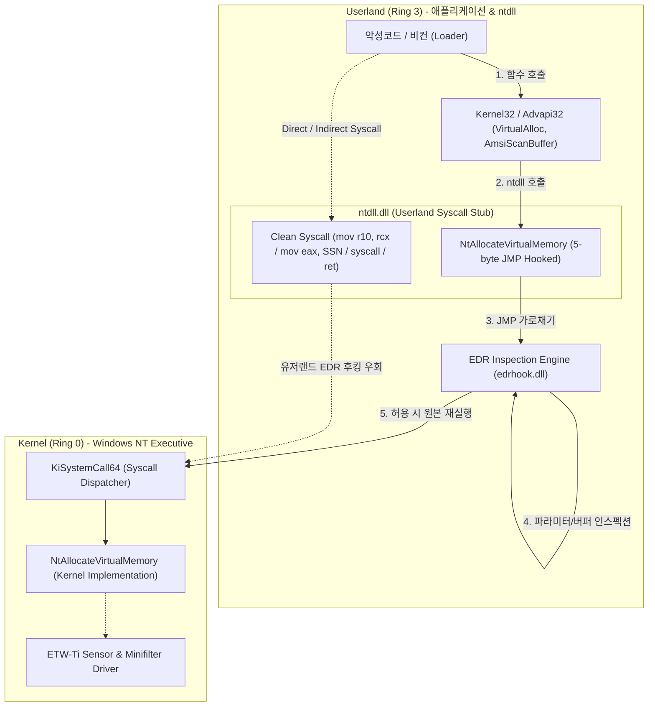
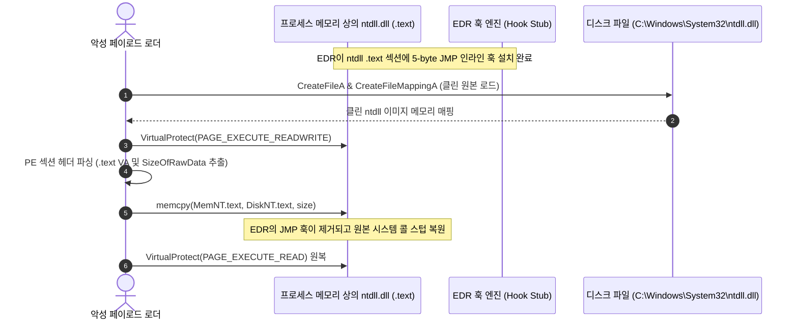
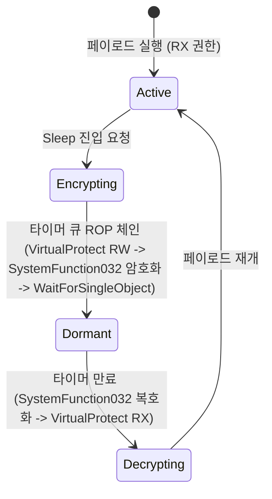

# EDR 유저랜드 후킹 해제 & 간접 시스템 콜 실전 심층 분석 (EDR Userland Unhooking & Indirect Syscalls Deep-dive)

> **섹션**: 55_Evasion_Techniques | **난이도**: 고급 (Advanced) | **대상**: 레드팀 오퍼레이터, 악성코드 분석관, EDR 보안 연구원, 엔드포인트 보안 엔지니어

---

## 1. 개요 및 현대 EDR 아키텍처의 해부

현대 엔드포인트 탐지 및 대응(EDR, Endpoint Detection and Response) 솔루션은 악성 프로세스의 행위를 실시간 감시하기 위해 운영체제의 유저 공간(Userland, Ring 3)과 커널 공간(Kernel, Ring 0) 양쪽에 센서를 배치합니다.

1. **커널 레벨 센서 (Ring 0)**:
   - **파일시스템 미니필터 (Minifilter)**: 파일 I/O 감시
   - **프로세스/스레드 생성 콜백 (`PsSetCreateProcessNotifyRoutineEx`, `PsSetCreateThreadNotifyRoutineEx`)**
   - **이미지 로드 콜백 (`PsSetLoadImageNotifyRoutine`)**
   - **ETW-Ti (Threat Intelligence ETW)**: 시스템 콜 진입점, 메모리 할당(`NtAllocateVirtualMemory`), 실행 권한 변경(`NtProtectVirtualMemory`) 감시
2. **유저랜드 인라인 후킹 (Ring 3)**:
   - 커널 수준의 이벤트는 발생 빈도가 매우 높아 모든 파라미터(문자열, 메모리 버퍼, 호출 스택)를 심층 검사하기에 시스템 오버헤드가 과도합니다.
   - 따라서 대부분의 상용 EDR은 타깃 프로세스가 생성될 때 EDR의 동적 라이브러리(예: `edrhook.dll`, `sentinel.dll`)를 주입(DLL Injection)하고, 핵심 API 집합인 `ntdll.dll` 및 `kernel32.dll`의 주요 함수 시작 부분에 무조건 분기 명령어(`jmp <EDR_Inspection_Stub>`)를 덮어씁니다(Inline Hooking).



---

## 2. 유저랜드 AMSI 및 ETW 인라인 패치 기법

### 2.1 AMSI (Antimalware Scan Interface) 인라인 패칭
PowerShell, .NET, WScript 등의 스크립트 실행 엔진은 메모리 상에서 스크립트를 파싱할 때 `amsi.dll!AmsiScanBuffer`를 호출하여 백신/EDR에 검사를 위임합니다.
악성코드는 대상 프로세스 내 `AmsiScanBuffer` 함수의 시작 부분을 조작하여 항상 "정상(Clean)" 코드를 즉시 반환하도록 패치합니다.

* **x64 어셈블리 패치 바이트**:
  ```assembly
  mov eax, 0x80070057    ; E_INVALIDARG (유효하지 않은 인자 에러)
  ret
  ```
  기계어 바이트: `b8 57 00 07 80 c3`
* 또는 성공 판정 및 버퍼 클린 반환:
  ```assembly
  xor eax, eax           ; S_OK (0)
  ret
  ```
  기계어 바이트: `31 c0 c3`

### 2.2 ETW (Event Tracing for Windows) 인라인 패칭
.NET 런타임 및 CLR 로더의 행위(어셈블리 메모리 로딩, 리플렉션 호출)는 `ntdll.dll!EtwEventWrite`를 통해 커널 및 EDR 리스너로 브로드캐스팅됩니다.
`EtwEventWrite` 시작 주소에 무조건 반환 명령어 `ret` (`0xc3`) 또는 `xor eax, eax; ret` (`0x31, 0xc0, 0xc3`)를 덮어쓰면, 유저랜드에서 발생하는 보안 원격 원격 로그 생성이 원천 차단됩니다.

```c
// 실전 AMSI / ETW 인라인 패치 구현 개념
BOOL PatchAmsiAndEtw() {
    DWORD oldProtect;
    
    // 1. AMSI 패치
    HMODULE hAmsi = LoadLibraryA("amsi.dll");
    void* pAmsiScan = GetProcAddress(hAmsi, "AmsiScanBuffer");
    VirtualProtect(pAmsiScan, 6, PAGE_EXECUTE_READWRITE, &oldProtect);
    // mov eax, 0x80070057; ret
    unsigned char amsiPatch[] = { 0xB8, 0x57, 0x00, 0x07, 0x80, 0xC3 };
    memcpy(pAmsiScan, amsiPatch, sizeof(amsiPatch));
    VirtualProtect(pAmsiScan, 6, oldProtect, &oldProtect);

    // 2. ETW 패치
    HMODULE hNtdll = GetModuleHandleA("ntdll.dll");
    void* pEtwWrite = GetProcAddress(hNtdll, "EtwEventWrite");
    VirtualProtect(pEtwWrite, 1, PAGE_EXECUTE_READWRITE, &oldProtect);
    unsigned char etwPatch[] = { 0xC3 }; // ret
    memcpy(pEtwWrite, etwPatch, sizeof(etwPatch));
    VirtualProtect(pEtwWrite, 1, oldProtect, &oldProtect);

    return TRUE;
}
```

---

## 3. ntdll.dll 디스크 언후킹 (Userland Unhooking)

EDR의 후킹은 디스크에 저장된 `C:\Windows\System32\ntdll.dll` 파일이 아니라, 프로세스 생성 시 메모리에 로드된 이미지의 `.text` 섹션에만 적용됩니다.
따라서 디스크에 있는 클린한 `ntdll.dll`을 읽어와 메모리의 오염된 `.text` 섹션을 원본 바이트로 덮어쓰면 EDR의 모든 유저랜드 후킹이 무력화됩니다.



### 3.1 KnownDlls를 활용한 언후킹
디스크 I/O 감시가 심한 경우 `\KnownDlls\ntdll.dll` 섹션 객체를 직접 열어(`NtOpenSection` + `MapViewOfFile`) 원본 코드를 가져오거나, 신규 프로세스를 서스펜드 상태(`CREATE_SUSPENDED`)로 생성한 뒤 EDR 주입 전 순수한 ntdll 메모리를 복사해오는 기법(Perun's Fart)이 활용됩니다.

---

## 4. 간접 시스템 콜 (Indirect Syscalls) & Dynamic SSN

### 4.1 직접 시스템 콜 (Direct Syscalls)의 한계와 탐지
`Syswhispers` 계열의 직접 시스템 콜(Direct Syscall)은 악성코드 자체 바이너리 내에 `syscall` 명령어를 내장하여 ntdll을 통하지 않고 직접 커널에 진입합니다.
그러나 이는 EDR의 **RIP / Call Stack 분석**에 의해 즉각 탐지됩니다:
* 정상적인 윈도우 프로그램의 커널 시스템 콜 진입은 항상 `ntdll.dll`의 주소 범위 내에서 일어납니다.
* 커널 진입 시 호출 스택의 반환 주소(`RIP`)가 `ntdll.dll` 외부(예: 힙, 스택, 비인가 익스큐터블 영역)를 가리키면 EDR은 즉각 이를 이상 징후로 탐지합니다.

### 4.2 간접 시스템 콜 (Indirect Syscalls) 메커니즘
간접 시스템 콜은 다음과 같은 원리로 EDR의 호출 스택 검사를 우회합니다:
1. 호출하고자 하는 시스템 콜의 고유 번호(SSN, System Service Number)를 메모리에서 동적으로 추출합니다.
2. `ntdll.dll` 내부에서 합법적으로 존재하는 `syscall; ret` 명령어 가젯의 주소를 찾습니다.
3. 시스템 콜 파라미터와 SSN을 레지스터(`R10`, `EAX`)에 세팅한 후, `ntdll.dll` 내부의 `syscall` 가젯 주소로 무조건 점프(`jmp`)합니다.
4. 커널 진입 시 반환 주소(Call Stack)는 완벽하게 합법적인 `ntdll.dll` 내부 영역을 가리키게 됩니다.

```assembly
; Indirect Syscall 스텁 (MASM x64)
.code

IndirectSyscall PROC
    mov r10, rcx                  ; 시스템 콜 첫 번째 인자 준비 (r10 <- rcx)
    mov eax, [g_SyscallSSN]       ; 동적으로 추출한 SSN (EAX)
    jmp QWORD PTR [g_SyscallGadget] ; ntdll 내부의 'syscall; ret' 가젯으로 분기
IndirectSyscall ENDP

END
```

### 4.3 동적 SSN 추출 알고리즘
Windows 버전 및 빌드마다 SSN 번호가 달라지므로 정적 하드코딩은 불가능합니다.
* **Hell's Gate**: ntdll 함수 주소의 첫 바이트를 확인하여 `4c 8b d1 b8 [SSN] 00 00` 패턴을 찾아 SSN을 추출합니다. 단, 해당 함수가 이미 EDR 훅에 의해 덮어씌워진 경우 실패합니다.
* **Halo's Gate**: EDR에 의해 첫 바이트가 `jmp`로 오염되어 있다면, 인접한 위/아래 이웃 함수 스텁을 스캔하여 SSN의 연속성을 통해 대상 함수의 SSN을 계산합니다 (`SSN = Neighbor_SSN ± 1`).
* **Tartarus' Gate**: 후킹이 함수 시작부뿐 아니라 16바이트 오프셋 안쪽에 걸려 있는 복합 훅 패턴까지 탐색하여 역산합니다.

---

## 5. 슬립 난독화 (Sleep Obfuscation - Ekko & Cronos)

EDR의 메모리 스캐너(예: Microsoft Defender, CrowdStrike Falcon, Elastic EDR)는 프로세스가 실행 중이 아닐 때 주기적으로 전체 프로세스 메모리를 스캔하여 YARA 시그니처 및 쉘코드 패턴을 탐지합니다.
C2 비컨(Beacon)은 99%의 시간을 `Sleep()` 상태로 대기하므로, 대기 시간 동안 자신의 메모리를 은닉해야 합니다.



1. **Ekko 기법의 ROP 체인 구성**:
   - `CreateTimerQueueTimer`를 사용하여 여러 개의 동기화 타이머를 순차 등록합니다.
   - 메인 스레드가 대기하는 동안 백그라운드 타이머 스레드가 다음 ROP 작업을 순차 실행합니다:
     - ① `VirtualProtect(pBeacon, size, PAGE_READWRITE, &old)`: 쉘코드 영역을 쓰기 가능으로 전환
     - ② `SystemFunction032(&pBeacon, &key)`: 쉘코드 메모리를 RC4/XOR로 암호화
     - ③ `WaitForSingleObject(hEvent, sleepDuration)`: 지정된 시간 동안 대기
     - ④ `SystemFunction032(&pBeacon, &key)`: 쉘코드 메모리 복호화
     - ⑤ `VirtualProtect(pBeacon, size, PAGE_EXECUTE_READ, &old)`: 원래 실행 권한(RX) 복원
2. **효과**:
   - 메모리 스캐너가 대기 중인 비컨 프로세스를 스캔할 때, 해당 영역은 실행 권한이 없는 `PAGE_READWRITE` 또는 `PAGE_NOACCESS`이며, 데이터는 암호화되어 있어 YARA 시그니처 매칭이 100% 실패합니다.

---

## 6. 방어 및 탐지 엔지니어링 (Blue Team Perspective)

보안 엔지니어와 블루팀은 이러한 고급 회피 기법을 다음과 같은 다계층 텔레메트리로 무력화합니다:

1. **Kernel ETW-Ti (Threat Intelligence) 감사**:
   - 커널 수준에서 `MiProtectVirtualMemory` 및 `PspCreateProcessNotifyRoutineEx`를 통해 유저랜드 후킹 해제나 메모리 권한 변조를 직접 감시합니다.
2. **합성 스택 검증 (Synthetic Stack Telemetry)**:
   - 커널 진입 시 실제 콜 스택의 프레임을 역추적하여 ntdll 이전 프레임의 바이너리 서명, 반환 주소의 유효성을 검증합니다.
3. **메모리 무결성 주기적 스캔 (Memory Integrity Scanners)**:
   - `PE-sieve`, `Moneta` 등의 툴을 활용하여 프로세스 내 ntdll의 인라인 패치 유무, Modified Code, 불일치 메모리 페이지(Private Commited vs Image Mapped)를 식별합니다.

---

## 7. 실습 랩 연계: Lab 38 EDRShield

본 챕터의 이론은 **Lab 38: EDRShield (EDR Evasion & Next-Gen C2 Lab)** 환경에서 실시간으로 시뮬레이션 및 테스트할 수 있습니다.
* **실행 명령**: `vhack lab start 38`
* **접속 주소**: `http://localhost:8038`
* **실습 내용**:
  - Stage 1: AMSI & ETW 인라인 버퍼 패치 및 시그니처 우회
  - Stage 2: Userland ntdll 인라인 훅 탐지 및 Fresh ntdll 디스크 언후킹
  - Stage 3: SSN 동적 추출 및 Indirect Syscall 실행
  - Stage 4: Ekko 슬립 난독화(ROP Timer Queue) 및 비컨 안전 대기
