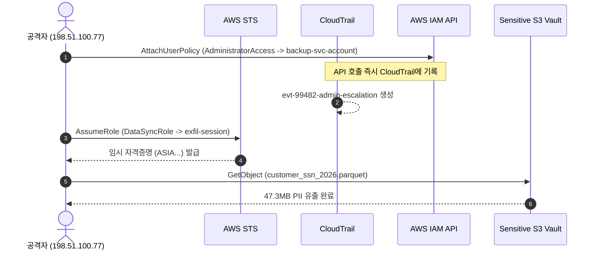
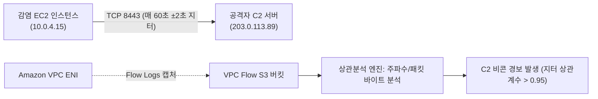

> 🌐 **Language / 언어**: [🇰🇷 한국어](#한국어) | [🇺🇸 English](#english)

---

<a name="한국어"></a>

# 클라우드 침해사고 대응(IR) 심층 분석: CloudTrail 감사, STS 자격증명 유출, VPC Flow Logs C2 상관분석 및 SOAR 자동 격리

> 🏢 **연계 실습 랩**: [Lab 43: CloudIRShield - Cloud Incident Response Lab](../../labs/43_cloud_incident_response_lab)  
> 🎯 **관련 워게임 트랙**: `cloudir` (클라우드 사고 대응 & 침해 위협 헌팅 35제)  
> 🛠️ **관련 시뮬레이터**: [Wargame Playground: CloudTrail & Multi-Cloud IR Inspector](../../wargame/index.html#playground)

---

## 0. 개요: 클라우드 환경 침해사고의 특수성과 증거 체계

클라우드 환경(AWS, Azure, GCP)에서의 침해사고는 기존 온프레미스 포렌식과 근본적으로 다른 패러다임을 요구합니다. 물리 서버나 하이퍼바이저에 대한 직접 접근이 불가능하며, 공격자는 운영체제 내부가 아닌 **클라우드 컨트롤 플레인(Control Plane API)**과 **임시 자격증명(STS / Managed Identity)**을 주요 표적으로 삼습니다.

```
+---------------------------------------------------------------------------------------------------+
|                        클라우드 다계층 침해사고 대응(Cloud IR) 포렌식 증거 체계                   |
+---------------------------------------------------------------------------------------------------+

  [컨트롤 플레인 계층]                 [네트워크/전송 계층]                 [워크로드/데이터 계층]
  ┌─────────────────────────┐         ┌─────────────────────────┐        ┌─────────────────────────┐
  │ AWS CloudTrail Logs     │         │ Amazon VPC Flow Logs    │        │ Amazon S3 Access Logs   │
  │ • API 호출자 (IAM/STS)  │         │ • ENI 출발지/목적지 IP  │        │ • GetObject / PutObject │
  │ • IP, UserAgent, 시간대 │         │ • 포트, 프로토콜, 패킷수│        │ • 전송 바이트수, STS 키 │
  │ • AttachUserPolicy 인가 │         │ • C2 주기적 비콘 상관분석│       │ • 민감 PII/인텔 유출 타임│
  └─────────────────────────┘         └─────────────────────────┘        └─────────────────────────┘
               │                                   │                                  │
               └─────────────────┬─────────────────┴──────────────────────────────────┘
                                 ▼
                     [GuardDuty & SIEM 상관분석 엔진]
                                 │
                     [자동화 SOAR 격리 플레이북 (Lambda)]
                     • active STS 세션 강제 무효화
                     • Explicit Deny 권한 경계 (Permission Boundary)
                     • 비인가 포트 차단 (Quarantine Security Group)
                     • EBS 볼륨 포렌식 스냅샷 불변 보존
```

본 심층 분석에서는 CloudTrail 관리/데이터 이벤트 분석, STS 토큰 탈취에 따른 데이터 유출 추적, VPC Flow Logs 기반의 C2 비콘 추출, 그리고 GuardDuty 경보와 연동된 자동화 SOAR 대응 프레임워크를 기술적으로 규명합니다.

---

## 1. CloudTrail 아키텍처 및 컨트롤 플레인 이상 징후 분석

CloudTrail은 AWS 계정 내에서 발생한 모든 API 호출을 불변의 JSON 레코드로 기록합니다. 공격자가 초기 거점(Initial Access)을 확보한 후 가장 먼저 시도하는 행위는 **권한 상승(Privilege Escalation)** 및 **지속성(Persistence)** 확보입니다.

### 이상 징후 식별 핵심 지표 (Athena 쿼리 예시)
```sql
SELECT 
    eventtime, 
    useridentity.type, 
    useridentity.arn, 
    sourceipaddress, 
    eventname, 
    requestparameters
FROM "cloudtrail_logs"
WHERE eventname IN ('AttachUserPolicy', 'CreateAccessKey', 'PutUserPolicy')
  AND sourceipaddress NOT LIKE '10.%'
  AND sourceipaddress NOT LIKE '172.16.%'
ORDER BY eventtime DESC;
```



---

## 2. STS 임시 자격증명 탈취와 S3 데이터 유출 포렌식

EC2 인스턴스 메타데이터 서비스(IMDSv1) 또는 환경변수 유출을 통해 획득한 STS 임시 토큰(`ASIA...`)은 클라우드 외부 어디에서든 유효 기간 동안 API 호출에 사용될 수 있습니다.

### STS 포렌식 아티팩트
1. **AccessKeyId 접두사 식별**:
   - `AKIA...`: 영구 IAM User Access Key
   - `ASIA...`: STS 임시 세션 토큰 (Session Token 필수 수반)
2. **세션 수임자 ARN 역추적**:
   - `arn:aws:sts::<Account>:assumed-role/<RoleName>/<SessionName>` 구조에서 `SessionName`은 공격자가 지정한 임의 문자열로, 공격 그룹의 C2 작전 식별자 또는 자동화 도구 시그니처를 포함합니다.

---

## 3. VPC Flow Logs 기반 C2 비콘 상관분석

네트워크 레벨에서 공격자의 내부 감염 워크로드는 외부 C2 서버와 통신할 때 탐지를 회피하기 위해 지터(Jitter)가 적용된 주기적 비콘(Beacon)을 발송합니다.



---

## 4. GuardDuty 트리아지 및 자동화 SOAR 봉쇄 프레임워크

침해사고가 확인되었을 때 수동 대응은 수 분에서 수 시간이 소요되어 피해를 확산시킵니다. AWS EventBridge와 Lambda를 결합한 SOAR(Security Orchestration, Automation, and Response) 아키텍처는 밀리초 단위로 4단계 봉쇄를 자동 수행합니다.

1. **Active STS Session Revocation**: `aws:CurrentTime < [RevocationTimestamp]` 조건이 포함된 인라인 정책을 즉시 주입하여 발급된 모든 세션 토큰을 무효화.
2. **Permissions Boundary Explicit Deny**: 대상 역할에 전체 거부 정책 경계를 연결하여 추가 API 수행 차단.
3. **Quarantine Security Group 교체**: 모든 인바운드/아웃바운드 규칙이 제거된 `sg-quarantine`으로 즉시 변경.
4. **EBS Volume Forensic Snapshot**: 향후 법적 증거 보존(Chain of Custody)을 위해 감염 볼륨의 스냅샷 생성.

---

<a name="english"></a>

# Multi-Cloud Incident Response Deepdive: CloudTrail Audit, STS Token Forensics, VPC Flow Correlation & Automated SOAR Containment

> 🏢 **Hands-on Lab**: [Lab 43: CloudIRShield - Cloud Incident Response Lab](../../labs/43_cloud_incident_response_lab)  
> 🎯 **Wargame Track**: `cloudir` (Cloud Incident Response & Threat Hunting 35 Challenges)  
> 🛠️ **Simulator**: [Wargame Playground: CloudTrail & Multi-Cloud IR Inspector](../../wargame/index.html#playground)

---

## 0. Overview: Cloud Incident Response Paradigms

Cloud security incidents differ fundamentally from traditional host-centric digital forensics. In hyperscale multi-cloud environments (AWS, Azure, GCP), direct physical hardware and hypervisor access are abstracted away. Attackers prioritize exploiting **Control Plane APIs** and temporary credential stores (**AWS STS**, Azure Managed Identities).

### Key Forensics Layers
- **Control Plane**: Immutable audit trails recording identity, IP, user-agent, and parameters (e.g. AWS CloudTrail).
- **Network Flow**: Interface-level packet records without payload overhead for correlating egress C2 traffic (Amazon VPC Flow Logs).
- **Workload Data**: Bucket-level object request telemetry tracking unauthorized data harvesting (S3 Access Logs).

---

## 1. CloudTrail Architecture & Privilege Escalation Triage

AWS CloudTrail records API calls made by users, roles, and integrated services into tamper-evident S3 logs. Critical high-severity events that demand immediate triage include:
- `AttachUserPolicy` with `AdministratorAccess`
- `CreateAccessKey` without Multi-Factor Authentication
- `AuthorizeSecurityGroupIngress` exposing 0.0.0.0/0 to administrative ports (22, 3389)

---

## 2. STS Credential Theft & Data Exfiltration Forensics

Stolen `ASIA...` session keys allow adversaries to operate outside the AWS virtual private cloud perimeter. By correlating S3 Server Access Logs with CloudTrail assumed-role session identifiers, forensic responders can accurately quantify data loss volume and timeline.

---

## 3. VPC Flow Logs & Periodic C2 Beaconing Extraction

Outbound beaconing from compromised private instances (`10.0.4.15`) to external threat actor endpoints (`203.0.113.89:8443`) exhibits tight temporal clustering. Responders extract Delta-T metrics across connection start timestamps to confirm command-and-control infrastructure.

---

## 4. GuardDuty Triage & Multi-Layer SOAR Containment

Automated SOAR playbooks triggered by GuardDuty findings execute rapid, synchronized containment:
- Revoke active IAM sessions using policy revocation timestamps.
- Enforce explicit-deny permission boundaries.
- Detach active security groups and apply an ingress/egress quarantine SG.
- Capture point-in-time EBS volume snapshots for chain of custody preservation.
