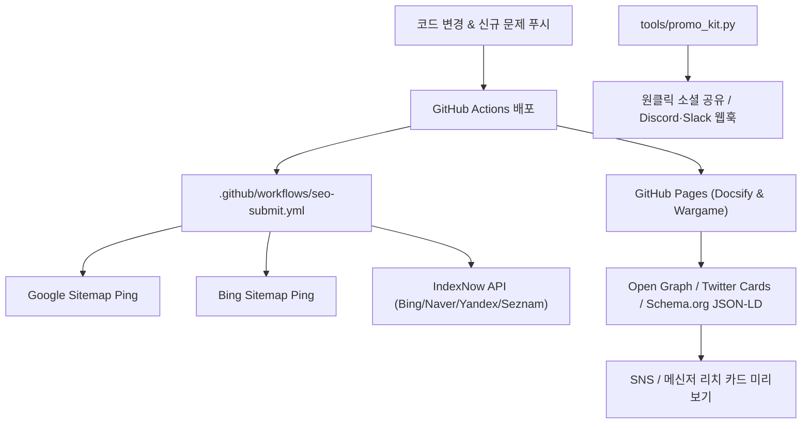

# VibeHacking 자동 웹 홍보 & 검색엔진 최적화 (SEO) 시스템

## 1. 개요 및 인덱싱 아키텍처

VibeHacking 프로젝트의 웹 노출과 검색엔진 자동 색인, 개발자 커뮤니티 전파를 위한 SEO 및 자동 홍보 파이프라인 구조입니다.



---

## 2. 검색엔진 최적화 (SEO) 적용 내역

### 1) 구조화 데이터 & 메타데이터 주입
- **루트 Docsify 포털 (`index.html`)**:
  - `Title`: 실전 사이버보안 완전 정복 바이블 (75개 섹션 · 38개 랩 · 1,820개 워게임)
  - `Description`: 75개 이론/실무 섹션, 38개 핸즈온 실습 랩, 52개 트랙 1,820개 브라우저 터미널 워게임, 8대 취약점 시뮬레이터
  - `Schema.org JSON-LD`: `Course`, `LearningResource` (강좌명, 교육 수준, 커리큘럼 세부 분야 구조화)
  - `Canonical URL`: `https://lsszz2100.github.io/VibeHacking/`
- **워게임 터미널 (`wargame/index.html`)**:
  - `Schema.org JSON-LD`: `WebApplication`, `GameApplication`, `EducationalApplication`
  - `Open Graph & Twitter Cards`: 1200x630 고해상도 다크 터미널 배너 (`assets/og-preview.svg`) 연동

### 2) 사이트맵 & 크롤러 규칙
- **`sitemap.xml` / `wargame/sitemap.xml`**:
  - sitemaps.org 0.9 표준 준수
  - 메인 포털, 워게임, 75개 교재 섹션, 38개 실습 랩 URL 전수 포함 (우선순위 0.75 ~ 1.0, 갱신주기 매핑)
  - `tools/generate_sitemap.py`로 언제든 원클릭 재색인 생성 가능
- **`robots.txt` / `wargame/robots.txt`**:
  - 모든 검색엔진 로봇(`User-agent: *`) 전체 수집 허용(`Allow: /`)
  - 사이트맵 절대 경로 지정

---

## 3. 실시간 색인 및 검색엔진 자동 제출 파이프라인

### 1) IndexNow 즉시 색인 (Instant Indexing)
- Microsoft Bing, 네이버(Naver Search), Yandex, Seznam에 실시간 URL 변경 배치 전송
- 인증 키: `4a8f9c12b7e53d0684a1e90f2b6c7d1e` (`4a8f9c12b7e53d0684a1e90f2b6c7d1e.txt`)
- API 엔드포인트: `https://api.indexnow.org/indexnow`

### 2) 검색엔진 자동 Ping 스크립트
```bash
# 로컬 드라이런 테스트
python3 tools/submit_seo_sitemap.py --dry-run

# 실제 검색엔진 핑 & IndexNow 전송
python3 tools/submit_seo_sitemap.py
```

### 3) GitHub Actions 자동 트리거
- `.github/workflows/seo-submit.yml`에 의해 `main` 브랜치에 문서/워게임/사이트맵이 커밋될 때마다 자동으로 실행됩니다.

---

## 4. 커뮤니티 자동 홍보 툴킷 (`tools/promo_kit.py`)

### 1) 원클릭 소셜 공유 링크
- **X (Twitter)**: 클릭 시 트윗 작성 창 자동 열림
- **Reddit**: r/netsec, r/cybersecurity 등록 창 자동 열림
- **LinkedIn**: 링크드인 피드 공유 창 자동 열림

### 2) CLI 명령어
```bash
# 전체 소셜 공유 링크 및 커뮤니티 포스팅 문안 출력
python3 tools/promo_kit.py

# 특정 플랫폼 맞춤 문안 출력 (geeknews, reddit, twitter, disquiet)
python3 tools/promo_kit.py --platform geeknews

# Discord 보안 채널 웹훅 자동 브로드캐스트 (환경변수 설정 시)
DISCORD_WEBHOOK_URL="https://discord.com/api/webhooks/..." python3 tools/promo_kit.py --broadcast
```
