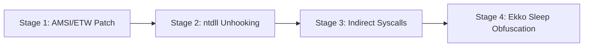

# Lab 38: EDRShield — EDR Evasion & Next-Gen C2 Lab

> **Port**: `8038` | **Type**: Hands-on EDR userland unhooking, indirect syscalls, and sleep obfuscation lab | **Difficulty**: Advanced

---

## 1. Overview

Modern Endpoint Detection and Response (EDR) solutions monitor malicious activity via userland inline hooks (`ntdll.dll` 5-byte JMP patches), AMSI/ETW memory scanning, kernel syscall verification, and background YARA memory scanners.
In this hands-on lab, operators analyze EDR detection mechanisms from a red-team perspective and demonstrate progressive evasion techniques.



---

## 2. Lab Stages & Flags

### Stage 1: AMSI & ETW In-Memory Patching
- **Concept**: Overwrite `AmsiScanBuffer` (`mov eax, 0x80070057; ret`) to force an invalid-arg error bypass, and patch `EtwEventWrite` (`ret`, `0xC3`) to silence security telemetry.
- **Endpoint**: `POST /api/edr/amsi-etw/patch`
- **Flag**: `FLAG{AMSI_ETW_INLINE_PATCH_MEMORY_BYPASS_8819}`

### Stage 2: ntdll.dll Disk Unhooking
- **Concept**: Detect EDR trampolines in the `.text` section of in-memory `ntdll.dll` and restore it using fresh bytes mapped from clean disk binaries (`C:\Windows\System32\ntdll.dll`).
- **Endpoint**: `POST /api/edr/ntdll/unhook`
- **Flag**: `FLAG{NTDLL_DISK_UNHOOKING_FRESH_COPY_RESTORED_7721}`

### Stage 3: Dynamic SSN Extraction & Indirect Syscalls
- **Concept**: Dynamically extract System Service Numbers (SSN) via Hell's Gate / Halo's Gate algorithms and jump to clean `syscall; ret` gadgets in `ntdll.dll` to keep call stack frames benign.
- **Endpoint**: `POST /api/edr/syscalls/invoke`
- **Flag**: `FLAG{INDIRECT_SYSCALL_HELLS_GATE_STACK_CLEAN_9934}`

### Stage 4: Sleep Obfuscation (Ekko Timer Queue ROP)
- **Concept**: Obfuscate sleeping beacon memory using `CreateTimerQueueTimer` ROP chains, changing protection to `PAGE_READWRITE` and encrypting payload memory via `SystemFunction032` to evade active YARA scanners.
- **Endpoint**: `POST /api/edr/c2/sleep-obfuscate`
- **Flag**: `FLAG{EKKO_SLEEP_OBFUSCATION_TIMER_QUEUE_ROP_4412}`

---

## 3. Verification & CLI Usage

```bash
# 1. Start Lab 38
vhack lab start 38

# 2. Access Web Console
http://localhost:8038

# 3. Run Unit & Integration Tests
pytest labs/38_edr_evasion_c2_lab/tests/test_edr_evasion_lab.py

# 4. Run Automated Exploitation Solvers
vhack solve 38 --step 1
vhack solve 38 --step 2
vhack solve 38 --step 3
vhack solve 38 --step 4
```
