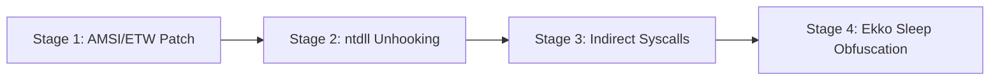

# Lab 38: EDRShield — EDR Evasion & Next-Gen C2 Lab

> **포트**: `8038` | **유형**: 차세대 EDR 유저랜드 후킹 우회, 간접 시스템 콜 및 슬립 난독화 실전 랩 | **난이도**: 고급 (Advanced)

---

## 1. 개요 (Overview)

현대 엔드포인트 보안 솔루션(EDR)은 유저랜드 API 인라인 후킹(`ntdll.dll` 5-byte JMP 패치), AMSI/ETW 인메모리 스캔, 커널 시스템 콜 진입점 검사, 그리고 백그라운드 YARA 메모리 스캐닝을 통해 악성 행위를 실시간 탐지 및 차단합니다.
본 실습 랩에서는 레드팀 오퍼레이터의 관점에서 EDR 센서의 탐지 메커니즘을 심층 이해하고, 이를 단계별로 우회하는 첨단 회피 기법을 실증합니다.



---

## 2. 실습 시나리오 및 플래그 (Stages & Flags)

### Stage 1: AMSI & ETW 인메모리 패칭 (In-Memory Patching)
- **개념**: 스크립트 엔진 메모리 검사 함수 `AmsiScanBuffer`를 패치(`mov eax, 0x80070057; ret`)하여 에러 반환을 유도하고, .NET 텔레메트리 전송 함수 `EtwEventWrite`를 `ret`(`0xC3`)로 덮어써 탐지 로깅을 침묵시킵니다.
- **엔드포인트**: `POST /api/edr/amsi-etw/patch`
- **플래그**: `FLAG{AMSI_ETW_INLINE_PATCH_MEMORY_BYPASS_8819}`

### Stage 2: ntdll.dll 디스크 언후킹 (Userland Unhooking)
- **개념**: 프로세스 메모리에 로드된 `ntdll.dll`의 `.text` 섹션에 설치된 EDR 인라인 훅(JMP Trampoline)을 탐지하고, 디스크 상의 원본 `C:\Windows\System32\ntdll.dll` 이미지를 매핑하여 오염된 메모리를 클린 바이트로 복원합니다.
- **엔드포인트**: `POST /api/edr/ntdll/unhook`
- **플래그**: `FLAG{NTDLL_DISK_UNHOOKING_FRESH_COPY_RESTORED_7721}`

### Stage 3: 동적 SSN 추출 및 간접 시스템 콜 (Indirect Syscalls)
- **개념**: Hell's Gate / Halo's Gate 알고리즘으로 빌드별 시스템 서비스 번호(SSN)를 동적으로 추출하고, ntdll 내부의 합법적 `syscall; ret` 가젯 주소로 점프하여 커널 진입 시 EDR의 Call Stack 검사를 완벽히 우회합니다.
- **엔드포인트**: `POST /api/edr/syscalls/invoke`
- **플래그**: `FLAG{INDIRECT_SYSCALL_HELLS_GATE_STACK_CLEAN_9934}`

### Stage 4: 슬립 난독화 (Sleep Obfuscation - Ekko Timer Queue ROP)
- **개념**: 비컨이 대기(Sleep) 상태일 때 `CreateTimerQueueTimer`를 활용한 ROP 체인을 트리거하여 메모리 영역을 `PAGE_READWRITE`로 전환하고 `SystemFunction032`(XOR/RC4)로 암호화함으로써 EDR 메모리 시그니처 스캐너를 무력화합니다.
- **엔드포인트**: `POST /api/edr/c2/sleep-obfuscate`
- **플래그**: `FLAG{EKKO_SLEEP_OBFUSCATION_TIMER_QUEUE_ROP_4412}`

---

## 3. 실행 및 테스트 (Execution & Verification)

```bash
# 1. 랩 단독 실행
vhack lab start 38

# 2. 웹 콘솔 접속
http://localhost:8038

# 3. 자동 무결성 테스트 실행
pytest labs/38_edr_evasion_c2_lab/tests/test_edr_evasion_lab.py

# 4. 자동 익스플로잇 솔버 실행
vhack solve 38 --step 1
vhack solve 38 --step 2
vhack solve 38 --step 3
vhack solve 38 --step 4
```
