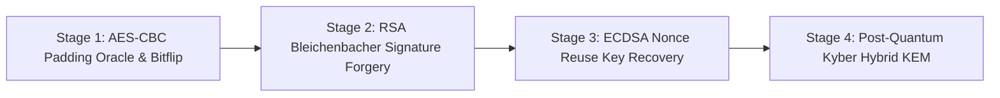

# Lab 39: CryptoShield — Modern Cryptography & Cryptanalysis Lab

> **Port**: `8039` | **Type**: Modern Applied Cryptography Vulnerabilities & Post-Quantum Hybrid KEM Lab | **Difficulty**: Advanced

---

## 1. Overview

In modern enterprise systems, cryptographic algorithms protect critical communications and credentials.
However, cipher mode pitfalls (CBC Padding Oracle), lax signature verification parsers (Bleichenbacher '06), broken nonce entropy (ECDSA Nonce Reuse), and quantum algorithms (Shor's Algorithm) expose architectures to severe compromise.
This lab walks through weaponized cryptographic attacks and implements NIST FIPS 203 Post-Quantum Hybrid Key Encapsulation (ML-KEM-768).



---

## 2. Stages & Flags

### Stage 1: AES-CBC Padding Oracle & Bit-Flipping
- **Concept**: Exploit PKCS#7 error responses or perform IV bit-flipping (`IV[6] ^= '0' ^ '1'`) to modify token privileges from guest to admin without decrypting or corrupting ciphertext blocks.
- **Endpoints**: `GET /api/crypto/cbc/profile`, `POST /api/crypto/cbc/oracle`, `POST /api/crypto/cbc/verify`
- **Flag**: `FLAG{CBC_PADDING_ORACLE_AND_BITFLIP_MASTER_8831}`

### Stage 2: RSA Bleichenbacher PKCS#1 v1.5 Signature Forgery (e=3)
- **Concept**: Exploit loose PKCS#1 v1.5 verification parser that accepts garbage bytes after DigestInfo. Compute integer cube root ($s = \lceil \sqrt[3]{D} \rceil$) to forge valid root signatures without private keys.
- **Endpoints**: `GET /api/crypto/rsa/pubkey`, `POST /api/crypto/rsa/verify-signature`
- **Flag**: `FLAG{RSA_BLEICHENBACHER_SIGNATURE_FORGERY_PWN_7742}`

### Stage 3: ECDSA Nonce Reuse Private Key Recovery
- **Concept**: Reusing the secret ephemeral nonce $k$ across two messages allows recovering $k = (z_1 - z_2)(s_1 - s_2)^{-1} \pmod n$ and carving private key $d = r^{-1}(s_1 k - z_1) \pmod n$.
- **Endpoints**: `GET /api/crypto/ecdsa/samples`, `POST /api/crypto/ecdsa/submit-key`
- **Flag**: `FLAG{ECDSA_REUSED_NONCE_PRIVATE_KEY_CARVED_9953}`

### Stage 4: Post-Quantum Cryptography (PQC) ML-KEM-768 Hybrid Defense
- **Concept**: Simulate Shor's algorithm breaking classical ECDH/RSA, then enable NIST FIPS 203 ML-KEM-768 (Kyber) + X25519 hybrid KEM to ensure forward secrecy against quantum interception.
- **Endpoints**: `POST /api/crypto/pqc/simulate-quantum-attack`, `POST /api/crypto/pqc/enable-hybrid`
- **Flag**: `FLAG{POST_QUANTUM_HYBRID_KYBER_KEM_IMMUNE_4421}`

---

## 3. Verification & Execution

```bash
vhack lab start 39
pytest labs/39_modern_cryptography_lab/tests/test_crypto_lab.py
vhack solve 39 --step 1
vhack solve 39 --step 2
vhack solve 39 --step 3
vhack solve 39 --step 4
```
