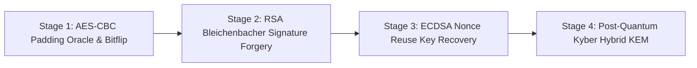

# Lab 39: CryptoShield — Modern Cryptography & Cryptanalysis Lab

> **포트**: `8039` | **유형**: 현대 응용 암호학 취약점 분석 및 포스트 퀀텀 하이브리드 키 교환 실전 랩 | **난이도**: 고급 (Advanced)

---

## 1. 개요 (Overview)

현대 엔터프라이즈 환경에서는 데이터 무결성과 기밀성을 보장하기 위해 대칭키 암호, 공개키 암호, 전자 서명 알고리즘을 사용합니다.
그러나 암호화 운용 모드의 취약점(CBC Padding Oracle), 불완전한 서명 검증 파서(Bleichenbacher '06), 난수 생성기 결함(ECDSA Nonce Reuse), 그리고 양자 컴퓨팅 위협(Shor's Algorithm)은 시스템을 심각한 침해에 노출시킵니다.
본 실습 랩에서는 실제 암호학 공격 벡터를 체계적으로 실증하고, NIST FIPS 203 포스트 퀀텀 하이브리드 키 교환을 통한 완화 기법을 학습합니다.



---

## 2. 실습 시나리오 및 플래그 (Stages & Flags)

### Stage 1: AES-CBC 패딩 오라클 & 비트 플리핑 (Padding Oracle & Bit-Flipping)
- **개념**: CBC 모드에서 PKCS#7 패딩 오류를 판별해주는 오라클 응답을 이용하여 암호문을 1바이트씩 복호화하거나, IV 비트 플리핑(`IV[6] ^= '0' ^ '1'`)을 통해 암호 블록 손상 없이 `admin=0`을 `admin=1`로 조작합니다.
- **엔드포인트**: `GET /api/crypto/cbc/profile`, `POST /api/crypto/cbc/oracle`, `POST /api/crypto/cbc/verify`
- **플래그**: `FLAG{CBC_PADDING_ORACLE_AND_BITFLIP_MASTER_8831}`

### Stage 2: RSA 취약 서명 검증 & Bleichenbacher PKCS#1 v1.5 위조 (e=3)
- **개념**: 공개 지수 $e=3$ 환경에서 PKCS#1 v1.5 서명 검증기가 패딩 길이를 끝까지 검사하지 않고 접두사만 파싱하는 취약점을 악용, 정수 세제곱근 계산($s = \lceil \sqrt[3]{D} \rceil$)을 통해 개인키 없이 유효한 서명을 위조합니다.
- **엔드포인트**: `GET /api/crypto/rsa/pubkey`, `POST /api/crypto/rsa/verify-signature`
- **플래그**: `FLAG{RSA_BLEICHENBACHER_SIGNATURE_FORGERY_PWN_7742}`

### Stage 3: ECDSA 난수 재사용 개인키 역산 (Nonce Reuse Private Key Carving)
- **개념**: 타원곡선 서명 생성 시 동일한 비밀 난수 $k$를 재사용하면, $k = (z_1 - z_2)(s_1 - s_2)^{-1} \pmod n$ 및 $d = r^{-1}(s_1 k - z_1) \pmod n$ 공식에 의해 개인키 $d$가 수학적으로 완벽히 노출됩니다.
- **엔드포인트**: `GET /api/crypto/ecdsa/samples`, `POST /api/crypto/ecdsa/submit-key`
- **플래그**: `FLAG{ECDSA_REUSED_NONCE_PRIVATE_KEY_CARVED_9953}`

### Stage 4: 포스트 퀀텀 암호(PQC) ML-KEM-768 하이브리드 키 교환 방어
- **개념**: 고전 ECDH 키 교환에 대한 Shor 알고리즘 모의 공격을 확인하고, NIST FIPS 203 격자 기반 암호(ML-KEM-768/Kyber)와 X25519를 결합한 하이브리드 KEM을 활성화하여 양자 도청 공격을 차단합니다.
- **엔드포인트**: `POST /api/crypto/pqc/simulate-quantum-attack`, `POST /api/crypto/pqc/enable-hybrid`
- **플래그**: `FLAG{POST_QUANTUM_HYBRID_KYBER_KEM_IMMUNE_4421}`

---

## 3. 실행 및 테스트 (Execution & Verification)

```bash
# 1. 랩 단독 실행
vhack lab start 39

# 2. 웹 콘솔 접속
http://localhost:8039

# 3. 자동 무결성 테스트 실행
pytest labs/39_modern_cryptography_lab/tests/test_crypto_lab.py

# 4. 자동 익스플로잇 솔버 실행
vhack solve 39 --step 1
vhack solve 39 --step 2
vhack solve 39 --step 3
vhack solve 39 --step 4
```
